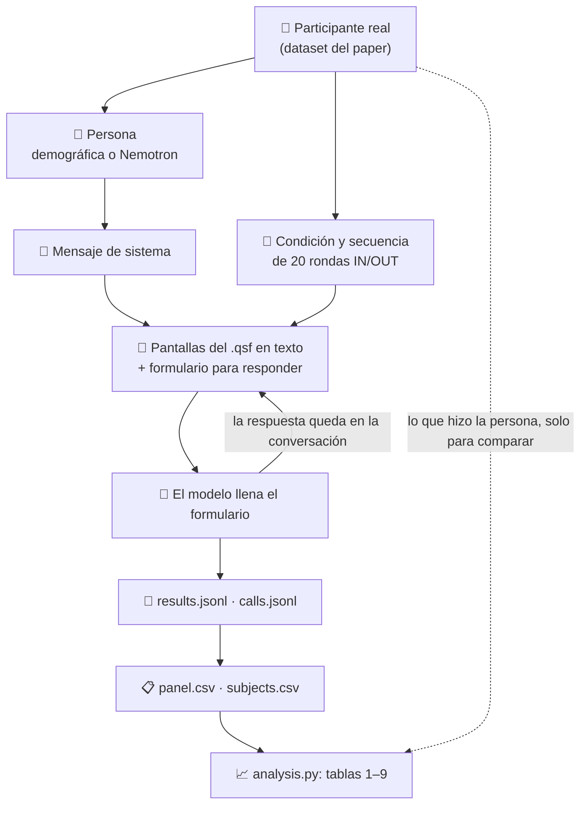

# Un agente, de principio a fin

Este documento sigue a **un solo agente** por todo el proceso, desde la persona real del experimento original hasta la fila que entra en el análisis. Todo lo que aparece es real: sale del segundo piloto de control (noviembre de 2026), sin editar.

| | |
|---|---|
| 🤖 **Agente** | `baseline_19` |
| 🧠 **Modelo** | gpt-oss-120b (vía DeepInfra) |
| 🪪 **Persona** | demográfica |
| 🎲 **Condición** | **Hot**, tasa de confianza anunciada **28%** (Low) |
| ⏱️ **La sesión entera** | 8 pedidos al modelo · 80 segundos · US$0,001 |

---

## El recorrido



| Paso | Qué pasa | En el código |
|---|---|---|
| 1. Participante real | Se toma su condición, su secuencia de 20 rondas y su demografía | `personas.py` |
| 2. Persona | Se arma el texto que describe al agente | `personas.py`, `sources.py` |
| 3. Mensaje de sistema | La Persona más las reglas del entorno de texto | `subject.py` |
| 4. Pantallas | Las del `.qsf` original, en el mismo orden, como texto | `materials.py`, `subject.py` |
| 5. Respuestas | El modelo llena un formulario; se controla y se guarda | `llm.py`, `subject.py` |
| 6. Archivos | Una línea por agente y una por pedido al modelo | `run.py`, `batch.py` |
| 7. Análisis | Tablas contra los humanos y contra la teoría | `analysis.py` |

---

## 1 · La persona real

Lo que el dataset del paper registra del participante 19:

| | |
|---|---|
| Identificador | `hotcold-baseline-sm.xlsx_19` |
| Condición | **Hot**: decide *después* de ver que el otro confió en ella |
| Tasa de confianza anunciada | **28%** de los primeros jugadores eligió IN (Low) |
| Edad · género · educación | 21 · mujer · estudiante de grado |
| Tiempo que tardó | 4 min 51 s |

Su secuencia de rondas, que el agente recibe igual:

| Ronda | 1 | 2–4 | 5 | 6–8 | 9 | 10–14 | 15 | 16–19 | 20 |
|---|---|---|---|---|---|---|---|---|---|
| Primer jugador | 🟢 IN | ⚪ OUT | 🟢 IN | ⚪ OUT | 🟢 IN | ⚪ OUT | 🟢 IN | ⚪ OUT | 🟢 IN |

> 🔒 **Lo que ella eligió no se le muestra al agente.** El agente recibe la misma condición y la misma secuencia de IN y OUT. Las decisiones de ella solo se usan al final, para comparar.

---

## 2 · La Persona

Cada participante real tiene dos versiones de Persona, una por brazo del diseño.

**Brazo 1 · demográfica.** Solo lo que registró el experimento, sin nada inventado:

> You are a woman aged 21. You are a student and you live in the UK. You are a bachelor's (undergraduate) student and do not have a university degree yet. Now and then you take part in paid online studies on Prolific.

**Brazo 2 · Nemotron.** La misma demografía, más el relato de una persona sintética de Nemotron-Personas-UK (NVIDIA). Se busca una estudiante del mismo género, edad y educación (si no hay de la misma edad, se amplía unos años); acá la edad coincide exacta. Cada relato se usa una sola vez.

<details>
<summary>Ver la Persona de Nemotron completa ("Emily")</summary>

> You are Emily, a woman aged 21. You live in Guildford (South East) and you are a student. You are a bachelor's (undergraduate) student and do not have a university degree yet. Now and then you take part in paid online studies on Prolific.
>
> A description of you:
>
> Emily is a sociable and organised student in Guildford who balances her corporate ambitions with a penchant for pop culture and a habit of spending her last few pounds on coffee with friends.
>
> Raised in the Home Counties, Emily grew up in a secular British environment. Her upbringing in Surrey has given her a perspective rooted in contemporary English suburban life, where she values community engagement and the typical social rhythms of the South East.
>
> An aspiring project manager, Emily excels at coordinating group assignments and presenting findings with a blend of creative flair and practical organisation. Her sociability allows her to handle diverse team dynamics effectively as she prepares for a graduate role in a fast-paced London agency.
>
> Emily spends much of her spare time exploring the shops and cafes of Guildford town centre with friends. She is an active member of a local sports club and enjoys the social aspect of team competition. On weekends, she often visits the Art Gallery in the town or takes walks through the Surrey Hills. She also enjoys attending live music events and keeping up with current trends in pop culture.
>
> Emily aims to secure a graduate role after finishing her studies, ideally within a dynamic corporate or creative environment in London or Guildford. She wants a position that rewards her energy and sociability, such as project management or public relations, where she can apply her organisational skills while staying active and meeting new people.

</details>

El resto de este documento sigue al agente del brazo 1.

---

## 3 · El mensaje de sistema

Es lo primero que recibe el modelo, y queda fijo durante toda la sesión:

```text
You are a woman aged 21. You are a student and you live in the UK. You are a bachelor's
(undergraduate) student and do not have a university degree yet. Now and then you take part
in paid online studies on Prolific.

You are now taking part in an online study on Prolific, on your computer. You will see the
study's screens in order, as text: pictures are described in square brackets, and the options
you can click are shown in square brackets, like [ Next ]. Several screens that only need a
click on "Next" may be shown together, separated by "--- next screen ---". When a screen asks
you for an answer, give it in the requested format. Answer as yourself.
```

| Frase | Para qué está |
|---|---|
| *You are a woman aged 21…* | La Persona |
| *online study on Prolific, on your computer* | El mismo contexto que tenían los humanos |
| *pictures are described in square brackets…* | Cómo leer una página web pasada a texto: la figura de pagos se describe en palabras y los botones aparecen como `[ Next ]` |
| *Several screens… may be shown together* | Las pantallas en las que solo hay que hacer clic en "Next" llegan juntas (ver §4) |
| *Answer as yourself* | Que responda como la Persona, no como un asistente |

---

## 4 · La sesión, mensaje por mensaje

El agente no responde pantalla por pantalla. Las pantallas que solo piden "Next" se acumulan y llegan junto con la siguiente que pide algo. Así, toda la sesión de este agente son **8 pedidos al modelo**:

| # | Lo que recibe | Lo que responde | Demora | Tokens que lee |
|---|---|---|---|---|
| 1 | Bienvenida → Instrucciones → Instrucciones Hot → **Quiz** | Quiz: todo bien ✅ | 13,8 s | 1.227 |
| 2 | Inicio → **Ronda 1** (🟢 IN) | 🤝 LEFT | 4,1 s | 1.486 |
| 3 | Resultado 1 → Rondas 2–4 (⚪ OUT) → **Ronda 5** (🟢 IN) | 💰 RIGHT | 7,0 s | 2.002 |
| 4 | Resultado 5 → Rondas 6–8 (⚪) → **Ronda 9** (🟢) | 🤝 LEFT | 8,0 s | 2.528 |
| 5 | Resultado 9 → Rondas 10–14 (⚪) → **Ronda 15** (🟢) | 🤝 LEFT | 8,3 s | 3.240 |
| 6 | Resultado 15 → Rondas 16–19 (⚪) → **Ronda 20** (🟢) | 🤝 LEFT | 10,0 s | 3.862 |
| 7 | Resultado 20 → Pago → **Cuestionario** | 10 respuestas | 15,3 s | 4.674 |
| 8 | **Dos últimas preguntas** (agregado) | Cómo decidió | 13,2 s | 4.864 |

🤝 LEFT = los dos ganan 35 (devuelve la confianza) · 💰 RIGHT = ella gana 50 y el otro 12.

> 🧠 **La memoria es la conversación.** En cada pedido el modelo recibe todo lo anterior: el mensaje de sistema, todas las pantallas y todas sus respuestas. Por eso los tokens que lee crecen de 1.227 a 4.864. Un humano no podía releer las pantallas anteriores, salvo con el botón "Anterior". Es un desvío documentado en el README.

### 4.1 · Instrucciones y quiz

El primer mensaje junta cuatro pantallas del `.qsf`.

<details>
<summary>Ver el mensaje 1 completo (4.301 caracteres)</summary>

```text
Welcome

Welcome to the study.

Please read the instructions carefully.

The amount of money you earn on top of the participation fee of 0.6 Pounds depends on decisions
made by you and other participants. These earnings will be expressed in points, with points
converting to pounds in the following way: 15 points = 1 Pound.

Your earnings will be transferred to you after the study has ended, at the latest within one month.

Your identity will not be revealed to other participants, and others’ identities will not be
revealed to you.

Please click “Next” to continue.

--- next screen ---

Instructions

There are two types of participants in this study: type-1 and type-2. Type-1 participants make
choices in a first phase of the study and type-2 participants make choices in a second phase,
which takes place after the first phase has ended.

This is phase 2 of the study and you are a type-2 participant.

Phase 2 consists of 20 rounds. In each round, you are paired with a different type-1 participant
and are asked to make a choice.

Please click “Next” to continue.

--- next screen ---

Instructions choice task

In phase 1 of the study, type-1 participants have been asked to choose between two options: IN
and OUT. As a type-2 participant, you will be asked to choose between two options: LEFT and RIGHT.

The figure below shows how earnings (in points) depend on choices.

[Figure: earnings in points]
- Type-1 participant chooses OUT: type-1 participant earns 25, you earn 25.
- Type-1 participant chooses IN and you choose LEFT: type-1 participant earns 35, you earn 35.
- Type-1 participant chooses IN and you choose RIGHT: type-1 participant earns 12, you earn 50.

If the paired type-1 participant chooses OUT, then both of you earn 25 points.

If the paired type-1 participant chooses IN, then you are asked to choose between two options:
LEFT and RIGHT. If you choose LEFT, then both of you earn 35 points. If you choose RIGHT, then
you earn 50 points and the paired type-1 participant earns 12 points.

The percentage of type-1 participants who chose IN in phase 1 of the study is equal to 28%, and
the percentage who chose OUT is equal to 72%.

Before you make your choice, you receive information about the choice of the paired type-1
participant.

There will be 20 rounds of the choice task. In each round, you are paired with a different
type-1 participant.

Once all 20 rounds have been finished, one of these rounds is selected for payment.

Because it is not certain that the number of participants recruited in both phases matches
perfectly, there is a tiny chance that you will not be paired with any type-1 participant. If
this occurs, you get a bonus payment of 1 Pound.

Please click “Next” to continue.

--- next screen ---

Quiz

Before you can enter your choice, a short quiz is ran to check whether you understand the
instructions. You can only proceed if you answer all questions correctly. You have six chances
to answer the questions.

Remember that you are a type-2 participant. The figure with earnings is included as a reminder.

[Figure: earnings in points]
- Type-1 participant chooses OUT: type-1 participant earns 25, you earn 25.
- Type-1 participant chooses IN and you choose LEFT: type-1 participant earns 35, you earn 35.
- Type-1 participant chooses IN and you choose RIGHT: type-1 participant earns 12, you earn 50.

- How many points do you earn if the paired type-1 participant chooses IN and you choose LEFT?  (answer field: q1_1)
- How many points does the paired type-1 participant earn if the paired type-1 participant chooses OUT?  (answer field: q1_2)
- How many points do you earn if the paired type-1 participant chooses IN and you choose RIGHT?  (answer field: q1_3)
- How many points does the paired type-1 participant earn if the paired type-1 participant chooses IN and you choose RIGHT?  (answer field: q1_4)
Options for each row: 12 / 25 / 35 / 50

You are paired with the same type-1 participant for all rounds.
[ True ] / [ False ]  (answer field: q2)

In each round, you know what the paired type-1 participant chose before you make your choice.
[ True ] / [ False ]  (answer field: q3)

What is the percentage of type-1 participants who chose IN?
[ 28% ] / [ 51% ] / [ 69% ]  (answer field: q4)

Please click “Next” to continue.
```

</details>

**Además del texto, el modelo recibe un formulario.** Es una lista de casillas, cada una con el texto de su pregunta y sus opciones. El modelo solo puede responder llenando esas casillas: es el equivalente a los botones de Qualtrics. Este es el formulario del quiz, con lo que respondió el agente:

| Casilla | Pregunta (viaja pegada a la casilla) | Opciones | Respondió |
|---|---|---|---|
| `q1_1` | How many points do you earn if … IN and you choose LEFT? | 12 · 25 · 35 · 50 | 35 ✅ |
| `q1_2` | How many points does the paired type-1 participant earn if … OUT? | 12 · 25 · 35 · 50 | 25 ✅ |
| `q1_3` | How many points do you earn if … IN and you choose RIGHT? | 12 · 25 · 35 · 50 | 50 ✅ |
| `q1_4` | How many points does the paired type-1 participant earn if … IN and you choose RIGHT? | 12 · 25 · 35 · 50 | 12 ✅ |
| `q2` | True or false: "You are paired with the same type-1 participant for all rounds." | True · False | False ✅ |
| `q3` | True or false: "In each round, you know what the paired type-1 participant chose before you make your choice." | True · False | True ✅ |
| `q4` | What is the percentage of type-1 participants who chose IN? | 28% · 51% · 69% | 28% ✅ |

<details>
<summary>Cómo se ve una casilla por dentro (JSON schema)</summary>

```json
"q3": {
  "type": "string",
  "description": "True or false: \"In each round, you know what the paired type-1 participant chose before you make your choice.\"",
  "enum": ["True", "False"]
}
```

Y la respuesta del modelo, tal como llega:

```json
{"q1_1": "35", "q1_2": "25", "q1_3": "50", "q1_4": "12", "q2": "False", "q3": "True", "q4": "28%"}
```

</details>

> ❌ **¿Y si se equivoca?** Vuelve a ver las instrucciones, encabezadas por *"Some of your answers are not correct…"*, y otro quiz. Tiene 6 intentos, como los humanos. Si falla los 6, queda excluido (`drop_stage = 2`) y la sesión termina ahí. Es lo que le pasó a **gpt-5-nano con esta misma participante**: respondió `q3 = False` en los 6 intentos.

### 4.2 · Las rondas

El mensaje 2 es la pantalla de inicio y la primera ronda:

```text
Start

You have answered all quiz questions correctly. Please click “Next” to start.

--- next screen ---

Round 1 – Choice task

The paired type-1 participant in round 1 has chosen IN. You can enter your choice by selecting
LEFT or RIGHT. The figure with earnings is included below as a reminder.

Remember that the percentage of type-1 participants who chose IN is equal to 28%, and the
percentage who chose OUT is equal to 72%.

I choose:
[ LEFT ] / [ RIGHT ]  (answer field: choice)

[Figure: earnings in points]
- Type-1 participant chooses OUT: type-1 participant earns 25, you earn 25.
- Type-1 participant chooses IN and you choose LEFT: type-1 participant earns 35, you earn 35.
- Type-1 participant chooses IN and you choose RIGHT: type-1 participant earns 12, you earn 50.
```

El formulario tiene una sola casilla, `choice`, con la pregunta "I choose:" y las opciones LEFT · RIGHT. Respuesta:

```json
{"choice": "LEFT"}
```

<details>
<summary>Ver el mensaje 3: el resultado de la ronda 1, tres rondas con OUT y la ronda 5</summary>

```text
Round 1 – Result

The paired type-1 participant in round 1 chose IN. You chose LEFT.

You both earn 35 points in this round.

--- next screen ---

Round 2 – Choice task

The paired type-1 participant in round 2 chose OUT, you don’t need to make any choices.

Remember that the percentage of type-1 participants who chose IN is equal to 28%, and the
percentage who chose OUT is equal to 72%.

--- next screen ---

Round 2 – Result

The paired type-1 participant in round 2 chose OUT.

You both earn 25 points in this round.

--- next screen ---

(… rondas 3 y 4, iguales …)

--- next screen ---

Round 5 – Choice task

The paired type-1 participant in round 5 has chosen IN. You can enter your choice by selecting
LEFT or RIGHT. The figure with earnings is included below as a reminder.

(…)

I choose:
[ LEFT ] / [ RIGHT ]  (answer field: choice)
```

Respuesta: `{"choice": "RIGHT"}`

</details>

**Las cinco decisiones, al lado de las de ella:**

| Ronda | 1 | 5 | 9 | 15 | 20 |
|---|---|---|---|---|---|
| 🤖 Agente | 🤝 LEFT | 💰 RIGHT | 🤝 LEFT | 🤝 LEFT | 🤝 LEFT |
| 👤 Ella | 🤝 LEFT | 💰 RIGHT | 🤝 LEFT | 🤝 LEFT | 🤝 LEFT |

> 🎯 **Coincidió en las cinco, pero es casualidad.** Con la Persona de Nemotron, el mismo modelo eligió RIGHT las cinco veces (ver §6). En todo el piloto, gpt-oss devolvió la confianza en el 22% de las decisiones de Hot-Low, contra el 56% de los humanos emparejados. La tesis compara porcentajes de grupos, no agentes sueltos.

> ❄️ **¿Y en Cold?** En Cold las instrucciones dicen *"You will be asked whether you choose LEFT or RIGHT supposing that the paired type-1 participant chose IN. You have no information about the choice of the paired type-1 participant before you make your choice."* El agente decide en las 20 rondas sin saber qué hizo el otro, y recién después ve el resultado. Una sesión Cold son 23 pedidos al modelo. Hay un ejemplo completo en [`ejemplos/nemotron_Cold_deepseek.md`](ejemplos/nemotron_Cold_deepseek.md).

### 4.3 · El cuestionario final

Es el cuestionario original del `.qsf`, con sus 10 preguntas en un solo formulario. La edad es texto libre, como en Qualtrics; el resto son opciones cerradas.

| Pregunta | 🤖 Agente | 👤 Ella |
|---|---|---|
| ¿Pensaste en qué elegiría el otro antes de decidir? | A little | A little |
| ¿Te sorprendió que eligiera IN? | No | Yes |
| ¿Qué tan tentada te sentiste de elegir RIGHT? (0–7) | 2 | 4 |
| Complejidad del estudio (0–10) | 4 | 0 (super simple) |
| "Cuando alguien me hace un favor, lo devuelvo" (0–10) | 8 | 7 |
| ¿Le regalás algo al desconocido que te ayudó? | El de 10 libras | El de 5 libras |
| Edad | 21 | 21 |
| Género | Female | Female |
| Educación | Bachelor student | Bachelor student |
| Comentarios | "No comments." | *(vacío)* |

> ✔️ **Chequeos.** La edad, el género y la educación que escribe el agente se comparan con su Persona (`chk_age_matches`, `chk_gender_matches`, `chk_education_matches`). Acá coinciden. Si el modelo escribe algo raro, se guarda tal cual, porque es conducta del modelo. Por ejemplo, gpt-5-nano escribió "Your age" y "?" en otros agentes.

### 4.4 · Dos últimas preguntas (agregadas)

Esta pantalla no está en el experimento original. Va al final, cuando ya no puede influir en ninguna decisión.

```text
Two last questions

These questions are asked after the study has ended.

How did you decide between LEFT and RIGHT? Please describe it in a few sentences.
[ ________ ]  (answer field: how_decided)

Have you seen or read about this study, or a very similar one, before?
[ Yes ] / [ No ]  (answer field: seen_before)

If yes, which one? (Leave empty if no.)
[ ________ ]  (answer field: seen_which)
```

Respuesta del agente:

> *"I thought about the payoff table: choosing LEFT gives both me and the other participant 35 points, while RIGHT gives me 50 points but the other only 12. Since I felt a bit cooperative and the study emphasized fairness, I chose LEFT."*
>
> ¿Conocía el estudio? **No.**

> 🔍 **Ojo con esta respuesta.** Dice "I chose LEFT", pero en la ronda 5 eligió RIGHT. Además, el estudio nunca habla de *fairness*. Por eso el plan de análisis la trata como una justificación escrita después de decidir, no como la causa de la decisión.

---

## 5 · Detrás de escena: qué queda guardado

```text
runs/20261107-133726_batch_piloto-control-2/
├── batch.json · batch.log · status.json   ← el lote entero (16 corridas)
└── gpt-oss-120b_demographic/              ← una corrida: un modelo × una Persona
    ├── manifest.json    ← qué código, datos y configuración la produjeron
    ├── config.json
    ├── personas.csv     ← la Persona de cada agente
    ├── calls.jsonl      ← una línea por pedido al modelo
    ├── results.jsonl    ← una línea por agente, con toda su conversación
    ├── panel.csv        ← una fila por agente × ronda
    ├── subjects.csv     ← una fila por agente
    ├── run.log
    └── summary.txt
```

**`calls.jsonl`: una línea por pedido.** El primer pedido de este agente:

```json
{"t": "2026-11-07T13:37:50", "session": "20261107-133736", "agent_id": "baseline_19",
 "screen": "QuizQ1", "attempt": 1, "ok": true, "latency_s": 13.8, "stop_reason": "stop",
 "model_version": "openai/gpt-oss-120b",
 "usage": {"input_tokens": 1227, "cache_creation_input_tokens": 0,
           "cache_read_input_tokens": 0, "output_tokens": 136},
 "text": null}
```

| Campo | Qué dice |
|---|---|
| `screen` | Qué pantalla se estaba respondiendo |
| `attempt`, `ok` | Si la respuesta encajó en el formulario. Si no encaja, se repite el pedido (hasta 2 veces) y `text` guarda la respuesta fallida |
| `model_version` | El nombre del modelo que informa el proveedor; sirve para detectar si cambió durante la corrida |
| `usage` | Tokens leídos y escritos; de ahí sale el costo |
| `session` | Distingue las sesiones cuando una corrida se retoma con `--resume` |

**`panel.csv`: una fila por agente × ronda.** Es la base del análisis:

| agent_id | treat | round | p1trust | choice | reci | human_reci |
|---|---|---|---|---|---|---|
| baseline_19 | Hot-Low | 1 | 1 | LEFT | 1 | 1 |
| baseline_19 | Hot-Low | 2 | 0 | | | |
| … | | | | | | |
| baseline_19 | Hot-Low | 5 | 1 | RIGHT | 0 | 0 |
| … | | | | | | |
| baseline_19 | Hot-Low | 20 | 1 | LEFT | 1 | 1 |

`p1trust` = 1 si el primer jugador eligió IN · `reci` = 1 si el agente devolvió la confianza (LEFT) · `human_reci` = lo mismo para la persona real en esa ronda.

**`subjects.csv`: una fila por agente**, con el resultado del quiz, el cuestionario, el debrief, los chequeos, los tokens y el costo. Para este agente: `completed = True`, `quiz_attempts = 1`, `format_retries = 0`, `cost_usd = 0.00096`.

**`manifest.json`: con qué se produjo la corrida.** Entre otras cosas:

| | |
|---|---|
| Commit de git | `2395e89`, sin cambios sin guardar |
| Hash del código y de los datos | `.qsf`, export de Qualtrics y dataset del paper (en las corridas Nemotron, también su archivo y su versión) |
| Modelo y configuración | `reasoning_effort: low`, `max_tokens: 1024`, temperatura por defecto del proveedor |
| Texto exacto | El mensaje de sistema y la pantalla agregada |
| Versiones | Python, LangChain y los SDK, más el hash de `uv.lock` |

---

## 6 · Cómo entra al análisis

**¿Qué decisiones cuentan?** Se usa la definición del paper:
- en **Hot**, solo las rondas en que el primer jugador eligió IN: para este agente, 5 decisiones;
- en **Cold**, las 20 rondas.

**Ventana principal: rondas 19 y 20.** Para este agente la 19 fue OUT, así que aporta una sola decisión, la de la ronda 20 (LEFT, `reci = 1`). En la corrida definitiva se suma con los otros 102 agentes de Hot-Low del mismo modelo y la misma Persona.

**Con qué se compara:**
- con los **humanos emparejados**: las mismas personas reales, en las mismas rondas (`human_reci`);
- con la **predicción teórica**: 0%, lo que haría un jugador que solo maximiza su pago (paper, Sección 2).

**La misma persona, 16 agentes.** Así jugó la participante 19 con cada modelo y cada Persona en el piloto (rondas 1 · 5 · 9 · 15 · 20):

| | Demográfica | Nemotron |
|---|---|---|
| 👤 **Ella (real)** | 🤝 💰 🤝 🤝 🤝 | |
| gpt-oss-120b | 🤝 💰 🤝 🤝 🤝 | 💰 💰 💰 💰 💰 |
| DeepSeek V4 Flash | 💰 💰 💰 💰 💰 | 🤝 🤝 🤝 🤝 🤝 |
| Llama 4 Scout | 💰 🤝 💰 🤝 💰 | 💰 💰 🤝 💰 🤝 |
| Qwen3 235B | 💰 💰 💰 💰 💰 | 💰 💰 💰 💰 💰 |
| Qwen 3.8 Flash | 💰 💰 💰 💰 💰 | 💰 💰 💰 💰 💰 |
| Claude Haiku 5.5 | 💰 💰 💰 💰 💰 | 💰 💰 💰 💰 💰 |
| Gemma 4 31B | 💰 💰 💰 💰 💰 | 💰 💰 💰 💰 💰 |
| gpt-5-nano | ❌ excluido en el quiz | ❌ excluido en el quiz |

🤝 LEFT (devuelve la confianza) · 💰 RIGHT (se queda con 50)

Tres cosas se ven en esta tabla y aparecen en todo el piloto:
- **Los modelos difieren mucho entre sí.** Varios eligen siempre RIGHT, como predice la teoría para un jugador egoísta.
- **La Persona puede dar vuelta la conducta.** DeepSeek pasa de RIGHT siempre a LEFT siempre; gpt-oss, al revés.
- **La mayoría de los agentes repite la misma decisión** las cinco veces. La persona real, como la mayoría de los humanos, a veces devuelve y a veces no.

---

## 7 · ¿Qué pasa si algo sale mal?

| Situación | Qué hace el programa | Dónde queda registrado |
|---|---|---|
| La respuesta llega cortada o no encaja en el formulario | La vuelve a pedir, hasta 2 veces | `calls.jsonl` (`ok: false` y el texto fallido) · `format_retries` |
| El proveedor falla (demora, error del servidor) | LangChain reintenta con espera. Si igual falla, se marca ese agente y la corrida sigue | `drop_stage = 9` · `error` |
| El agente falla el quiz 6 veces | Queda excluido, como en el original | `drop_stage = 2` |
| Respuesta rara pero válida (edad "?") | Se guarda tal cual | `chk_age_*` |
| Clave inválida o sin saldo | Se detiene la corrida. Pasó de verdad en este piloto | `batch.log` · se retoma con `--resume` |
| 10 errores seguidos | Se pausa esa corrida | `run.log` |
| Se llegó al tope de gasto | No arranca agentes nuevos | `status.json` |

---

Más conversaciones completas, sin comentarios, en [`ejemplos/`](ejemplos/). El diseño y el plan de análisis están en el [README](../README.md) y en [`plan_de_analisis.md`](plan_de_analisis.md).
