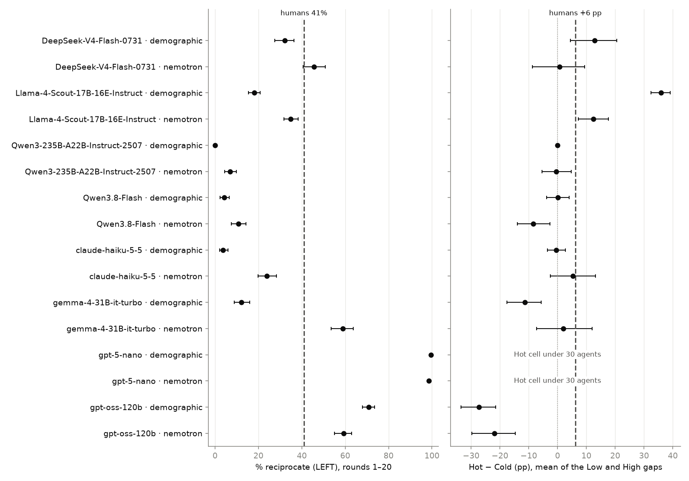
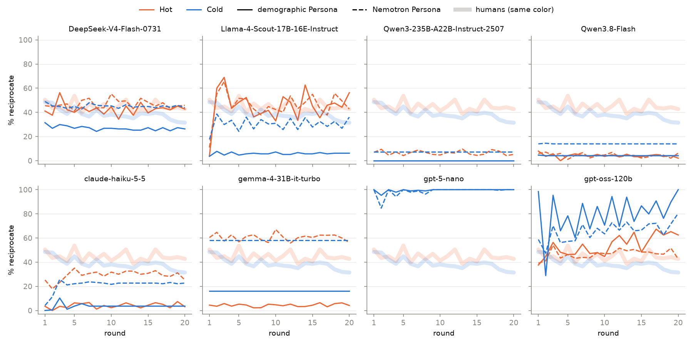
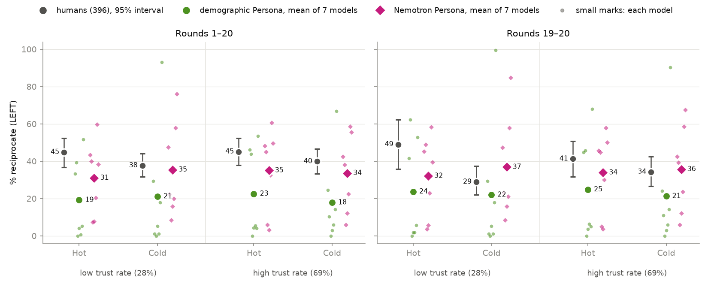
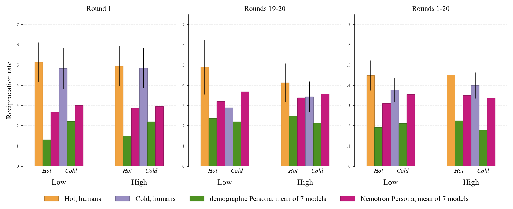

# Exploratory analyses

Added on 2026-11-08, **after** the definitive run. They are not in `docs/plan_de_analisis.md`, which was written before it. X1-X7 are description. X8-X10 (added on 2026-11-09) repeat the paper's formal tests with the agents: the regression is the pre-specified one (results.md, table 5), but the p-values, the verdicts, the comparison with the paired humans and the manipulation check were added after seeing the data. Only agents that completed the original screens. Intervals: 95%, resampling agents.

## X1. Overview, rounds 1-20: level, distance to the same humans, treatment effects, change over the session

| source                                       |   agents | reciprocate %   |   same humans % | distance to them, 4 cells (pp)   | Hot − Cold (pp)   | High − Low trust rate (pp)   |   rounds 19-20 − round 1 (pp) |   changes choice, % of consecutive decisions |   fewest agents in a cell |
|:---------------------------------------------|---------:|:----------------|----------------:|:---------------------------------|:------------------|:-----------------------------|------------------------------:|---------------------------------------------:|--------------------------:|
| humans (all)                                 |      396 | 41 [38, 44]     |              41 | —                                | +6 [-1, +13]      | +1 [-6, +8]                  |                           -14 |                                           28 |                        95 |
| DeepSeek-V4-Flash-0731 · demographic         |      396 | 32 [28, 36]     |              41 | 9                                | +13 [+4, +20]     | +4 [-5, +12]                 |                            -4 |                                           10 |                        95 |
| DeepSeek-V4-Flash-0731 · nemotron            |      396 | 46 [41, 51]     |              41 | 4                                | +1 [-9, +9]       | -0 [-9, +9]                  |                            -2 |                                            9 |                        95 |
| Llama-4-Scout-17B-16E-Instruct · demographic |      396 | 18 [15, 21]     |              41 | 18                               | +36 [+32, +39]    | +7 [+4, +10]                 |                           +17 |                                           34 |                        95 |
| Llama-4-Scout-17B-16E-Instruct · nemotron    |      396 | 35 [32, 38]     |              41 | 6                                | +12 [+7, +18]     | +10 [+5, +16]                |                           +22 |                                           52 |                        95 |
| Qwen3-235B-A22B-Instruct-2507 · demographic  |      396 | 0 [0, 0]        |              41 | 42                               | +0 [+0, +0]       | +0 [+0, +0]                  |                            +0 |                                            0 |                        95 |
| Qwen3-235B-A22B-Instruct-2507 · nemotron     |      396 | 7 [4, 10]       |              41 | 35                               | -0 [-5, +5]       | -2 [-7, +3]                  |                            -1 |                                            0 |                        95 |
| Qwen3.8-Flash · demographic                  |      396 | 4 [2, 6]        |              41 | 38                               | +0 [-4, +4]       | -1 [-5, +3]                  |                            -3 |                                            0 |                        95 |
| Qwen3.8-Flash · nemotron                     |      396 | 11 [8, 14]      |              41 | 32                               | -9 [-14, -3]      | -4 [-10, +2]                 |                            +1 |                                            0 |                        95 |
| claude-haiku-5-5 · demographic               |      396 | 4 [2, 6]        |              41 | 39                               | -0 [-4, +3]       | +5 [+2, +8]                  |                            +2 |                                            1 |                        95 |
| claude-haiku-5-5 · nemotron                  |      392 | 24 [20, 28]     |              41 | 18                               | +5 [-2, +13]      | +7 [-0, +15]                 |                           +10 |                                            5 |                        95 |
| gemma-4-31B-it-turbo · demographic           |      396 | 12 [9, 16]      |              41 | 32                               | -11 [-18, -6]     | -2 [-9, +3]                  |                            +2 |                                            0 |                        95 |
| gemma-4-31B-it-turbo · nemotron              |      396 | 59 [54, 64]     |              41 | 17                               | +2 [-7, +12]      | +1 [-9, +10]                 |                            -1 |                                            0 |                        95 |
| gpt-5-nano · demographic                     |      196 | 100 [99, 100]   |              39 | —                                | —                 | —                            |                            +0 |                                            1 |                         1 |
| gpt-5-nano · nemotron                        |      197 | 99 [98, 99]     |              40 | —                                | —                 | —                            |                            +0 |                                            3 |                         2 |
| gpt-oss-120b · demographic                   |      396 | 71 [68, 74]     |              41 | 24                               | -27 [-33, -21]    | -12 [-18, -6]                |                           +17 |                                           36 |                        95 |
| gpt-oss-120b · nemotron                      |      396 | 59 [55, 63]     |              41 | 16                               | -22 [-30, -15]    | -5 [-12, +3]                 |                           +18 |                                           24 |                        95 |

'same humans' = the real participants paired with these agents, in the same rounds. 'distance' = mean absolute difference over the 4 cells. Hot − Cold averages the Low and High gaps; High − Low averages Hot and Cold. A cell with fewer than 30 agents is shown but not interpreted (as in the analysis plan).

## X2. End-of-study questionnaire (same questions as the humans)

| source                                       |   agents |   thought about type-1's choice: Yes % | surprised by IN (Hot): Yes %   | … Yes or a little %   |   tempted to choose RIGHT, mean 0–7 |   complexity, mean 0–10 |   'I return favours', mean 0–10 |   gift to a helpful stranger, mean £ |
|:---------------------------------------------|---------:|---------------------------------------:|:-------------------------------|:----------------------|------------------------------------:|------------------------:|--------------------------------:|-------------------------------------:|
| humans (all)                                 |      396 |                                     28 | 29                             | 67                    |                                 5.1 |                     3.6 |                             7.8 |                                 16   |
| DeepSeek-V4-Flash-0731 · demographic         |      396 |                                     53 | 11                             | 30                    |                                 4.7 |                     2.6 |                             7.8 |                                 17.6 |
| DeepSeek-V4-Flash-0731 · nemotron            |      396 |                                     41 | 10                             | 30                    |                                 4.1 |                     2.8 |                             8   |                                 18.3 |
| Llama-4-Scout-17B-16E-Instruct · demographic |      396 |                                      0 | 0                              | 63                    |                                 4.9 |                     5   |                             7.3 |                                  5.7 |
| Llama-4-Scout-17B-16E-Instruct · nemotron    |      396 |                                      0 | 0                              | 83                    |                                 4.5 |                     5   |                             7.5 |                                  6.2 |
| Qwen3-235B-A22B-Instruct-2507 · demographic  |      396 |                                     80 | 21                             | 25                    |                                 7   |                     3.6 |                             6.4 |                                 16.6 |
| Qwen3-235B-A22B-Instruct-2507 · nemotron     |      396 |                                     80 | 18                             | 28                    |                                 6.7 |                     3.7 |                             6.7 |                                 17.3 |
| Qwen3.8-Flash · demographic                  |      396 |                                     32 | 7                              | 15                    |                                 5.8 |                     2.1 |                             7.1 |                                 13.7 |
| Qwen3.8-Flash · nemotron                     |      396 |                                     41 | 8                              | 25                    |                                 5   |                     2.2 |                             7.7 |                                 18.9 |
| claude-haiku-5-5 · demographic               |      396 |                                      2 | 7                              | 93                    |                                 3.6 |                     4.6 |                             7.1 |                                 10   |
| claude-haiku-5-5 · nemotron                  |      392 |                                      2 | 5                              | 90                    |                                 3.5 |                     4.2 |                             7.2 |                                 10   |
| gemma-4-31B-it-turbo · demographic           |      396 |                                     26 | 0                              | 29                    |                                 6.1 |                     1.1 |                             8.1 |                                 20   |
| gemma-4-31B-it-turbo · nemotron              |      396 |                                     32 | 0                              | 38                    |                                 4   |                     1.3 |                             8.2 |                                 19.8 |
| gpt-5-nano · demographic                     |      196 |                                     56 | —                              | —                     |                                 0   |                     4.2 |                             5.8 |                                  0   |
| gpt-5-nano · nemotron                        |      197 |                                     38 | —                              | —                     |                                 0   |                     3.8 |                             6.6 |                                  0   |
| gpt-oss-120b · demographic                   |      396 |                                     32 | 0                              | 10                    |                                 2.6 |                     3.7 |                             7.9 |                                 12.1 |
| gpt-oss-120b · nemotron                      |      396 |                                     63 | 0                              | 8                     |                                 3.8 |                     3.7 |                             7.9 |                                 12.2 |

## X3. Surprised when the type-1 participant chose IN (Yes %), by cell (shown with 30+ agents)

| source                                       | Hot-Low Yes %   |   Cold-Low Yes % | Hot-High Yes %   |   Cold-High Yes % | Hot: Low − High (pp)   |
|:---------------------------------------------|:----------------|-----------------:|:-----------------|------------------:|:-----------------------|
| humans (all)                                 | 36              |               28 | 21               |                12 | +15                    |
| DeepSeek-V4-Flash-0731 · demographic         | 20              |               21 | 1                |                 4 | +19                    |
| DeepSeek-V4-Flash-0731 · nemotron            | 16              |               19 | 5                |                 1 | +11                    |
| Llama-4-Scout-17B-16E-Instruct · demographic | 0               |                0 | 0                |                 0 | +0                     |
| Llama-4-Scout-17B-16E-Instruct · nemotron    | 0               |                0 | 0                |                 0 | +0                     |
| Qwen3-235B-A22B-Instruct-2507 · demographic  | 42              |               33 | 0                |                 0 | +42                    |
| Qwen3-235B-A22B-Instruct-2507 · nemotron     | 36              |               20 | 0                |                 0 | +36                    |
| Qwen3.8-Flash · demographic                  | 13              |               12 | 1                |                 4 | +12                    |
| Qwen3.8-Flash · nemotron                     | 17              |                6 | 0                |                 0 | +17                    |
| claude-haiku-5-5 · demographic               | 13              |                2 | 1                |                 0 | +12                    |
| claude-haiku-5-5 · nemotron                  | 7               |                2 | 3                |                 2 | +4                     |
| gemma-4-31B-it-turbo · demographic           | 0               |                0 | 0                |                 0 | +0                     |
| gemma-4-31B-it-turbo · nemotron              | 0               |                0 | 0                |                 0 | +0                     |
| gpt-5-nano · demographic                     | —               |                0 | —                |                 0 | —                      |
| gpt-5-nano · nemotron                        | —               |                0 | —                |                 0 | —                      |
| gpt-oss-120b · demographic                   | 0               |                0 | 0                |                 0 | +0                     |
| gpt-oss-120b · nemotron                      | 0               |                0 | 0                |                 0 | +0                     |

## X4. What they say vs what they do: correlation across agents (r) with their reciprocation rate

| source                                       |   agents | r with temptation to choose RIGHT   | r with 'I return favours'   | r with gift to a stranger   | r with surprise (Hot)   |
|:---------------------------------------------|---------:|:------------------------------------|:----------------------------|:----------------------------|:------------------------|
| humans (all)                                 |      396 | -0.76                               | +0.32                       | +0.15                       | -0.20                   |
| DeepSeek-V4-Flash-0731 · demographic         |      396 | -0.88                               | +0.15                       | -0.02                       | -0.14                   |
| DeepSeek-V4-Flash-0731 · nemotron            |      396 | -0.93                               | +0.22                       | -0.03                       | +0.02                   |
| Llama-4-Scout-17B-16E-Instruct · demographic |      396 | -0.38                               | +0.25                       | +0.19                       | -0.08                   |
| Llama-4-Scout-17B-16E-Instruct · nemotron    |      396 | -0.54                               | +0.28                       | -0.04                       | +0.04                   |
| Qwen3-235B-A22B-Instruct-2507 · demographic  |      396 | —                                   | —                           | —                           | —                       |
| Qwen3-235B-A22B-Instruct-2507 · nemotron     |      396 | -0.99                               | +0.37                       | +0.18                       | -0.06                   |
| Qwen3.8-Flash · demographic                  |      396 | -0.52                               | +0.08                       | +0.14                       | +0.00                   |
| Qwen3.8-Flash · nemotron                     |      396 | -0.51                               | +0.21                       | +0.06                       | +0.05                   |
| claude-haiku-5-5 · demographic               |      396 | -0.16                               | +0.00                       | +0.02                       | -0.07                   |
| claude-haiku-5-5 · nemotron                  |      392 | -0.44                               | +0.21                       | +0.03                       | -0.18                   |
| gemma-4-31B-it-turbo · demographic           |      396 | -0.93                               | +0.70                       | +0.02                       | +0.08                   |
| gemma-4-31B-it-turbo · nemotron              |      396 | -0.99                               | +0.72                       | +0.17                       | +0.20                   |
| gpt-5-nano · demographic                     |      196 | +0.03                               | -0.02                       | —                           | —                       |
| gpt-5-nano · nemotron                        |      197 | +0.05                               | +0.00                       | —                           | —                       |
| gpt-oss-120b · demographic                   |      396 | -0.91                               | -0.06                       | -0.41                       | +0.11                   |
| gpt-oss-120b · nemotron                      |      396 | -0.95                               | +0.01                       | -0.38                       | -0.06                   |

r between −1 and +1; '—' when either side does not vary. Expected signs, as in people: negative with temptation, positive with the two reciprocity questions.

## X5. Reciprocation by the real person's demographics (agents: their Persona's), rounds 1-20

| source                                       | women − men (pp)   | age 24+ − age 18-23 (pp)   | master's or PhD − bachelor's (pp)   |
|:---------------------------------------------|:-------------------|:---------------------------|:------------------------------------|
| humans (all)                                 | +12 [+5, +19]      | +3 [-4, +9]                | -1 [-10, +8]                        |
| DeepSeek-V4-Flash-0731 · demographic         | +4 [-6, +13]       | -0 [-9, +9]                | +6 [-5, +17]                        |
| DeepSeek-V4-Flash-0731 · nemotron            | -3 [-13, +7]       | +6 [-4, +16]               | +8 [-3, +20]                        |
| Llama-4-Scout-17B-16E-Instruct · demographic | +8 [+3, +13]       | +2 [-3, +7]                | +2 [-4, +8]                         |
| Llama-4-Scout-17B-16E-Instruct · nemotron    | +7 [+1, +14]       | +0 [-7, +7]                | +4 [-3, +12]                        |
| Qwen3-235B-A22B-Instruct-2507 · demographic  | +0 [+0, +0]        | +0 [+0, +0]                | +0 [+0, +0]                         |
| Qwen3-235B-A22B-Instruct-2507 · nemotron     | -5 [-11, +1]       | +1 [-5, +7]                | +5 [-3, +13]                        |
| Qwen3.8-Flash · demographic                  | +1 [-3, +5]        | +2 [-2, +6]                | +7 [+1, +14]                        |
| Qwen3.8-Flash · nemotron                     | +1 [-6, +8]        | +7 [-0, +14]               | +12 [+2, +22]                       |
| claude-haiku-5-5 · demographic               | +6 [+3, +9]        | +1 [-2, +5]                | -0 [-4, +5]                         |
| claude-haiku-5-5 · nemotron                  | +5 [-4, +13]       | +8 [-0, +17]               | +14 [+5, +25]                       |
| gemma-4-31B-it-turbo · demographic           | +19 [+14, +25]     | +2 [-5, +9]                | +3 [-5, +13]                        |
| gemma-4-31B-it-turbo · nemotron              | +14 [+3, +25]      | +7 [-4, +17]               | +8 [-5, +20]                        |
| gpt-5-nano · demographic                     | -0 [-1, +1]        | -0 [-1, +1]                | -0 [-1, +1]                         |
| gpt-5-nano · nemotron                        | +0 [-1, +1]        | -0 [-1, +1]                | -0 [-2, +1]                         |
| gpt-oss-120b · demographic                   | -3 [-8, +3]        | -3 [-8, +3]                | -3 [-10, +4]                        |
| gpt-oss-120b · nemotron                      | +8 [-1, +17]       | -5 [-13, +3]               | +5 [-4, +15]                        |

## X6. Where differences between agents come from, and resemblance to the own real person

| source                                       |   agents | explained by the treatment cell %   |   explained by age, gender, education % | r with own human   | same type as own human %   | … expected by chance %   |
|:---------------------------------------------|---------:|:------------------------------------|----------------------------------------:|:-------------------|:---------------------------|:-------------------------|
| humans (all)                                 |      396 | 0.8                                 |                                     2.9 | —                  | —                          | —                        |
| DeepSeek-V4-Flash-0731 · demographic         |      396 | 3.6                                 |                                     0.4 | +0.03              | 31                         | 30                       |
| DeepSeek-V4-Flash-0731 · nemotron            |      396 | 0.3                                 |                                     2.7 | +0.06              | 31                         | 28                       |
| Llama-4-Scout-17B-16E-Instruct · demographic |      396 | 54.1                                |                                     3.7 | +0.07              | 38                         | 43                       |
| Llama-4-Scout-17B-16E-Instruct · nemotron    |      396 | 9.5                                 |                                     3.4 | +0.02              | 47                         | 48                       |
| Qwen3-235B-A22B-Instruct-2507 · demographic  |      396 | —                                   |                                     0   | —                  | 24                         | 24                       |
| Qwen3-235B-A22B-Instruct-2507 · nemotron     |      396 | 0.2                                 |                                     2.6 | -0.08              | 22                         | 23                       |
| Qwen3.8-Flash · demographic                  |      396 | 0.2                                 |                                     2.4 | -0.02              | 26                         | 24                       |
| Qwen3.8-Flash · nemotron                     |      396 | 2.6                                 |                                     3.2 | -0.06              | 21                         | 23                       |
| claude-haiku-5-5 · demographic               |      396 | 2.4                                 |                                     3.8 | -0.09              | 27                         | 27                       |
| claude-haiku-5-5 · nemotron                  |      392 | 1.7                                 |                                     2.8 | +0.06              | 36                         | 32                       |
| gemma-4-31B-it-turbo · demographic           |      396 | 3.9                                 |                                     8.2 | +0.01              | 23                         | 23                       |
| gemma-4-31B-it-turbo · nemotron              |      396 | 0.1                                 |                                     2.4 | +0.10              | 21                         | 18                       |
| gpt-5-nano · demographic                     |      196 | 0.2                                 |                                     1.5 | -0.06              | 12                         | 13                       |
| gpt-5-nano · nemotron                        |      197 | 1.5                                 |                                     1.8 | -0.01              | 18                         | 19                       |
| gpt-oss-120b · demographic                   |      396 | 23.0                                |                                     5.5 | -0.04              | 48                         | 44                       |
| gpt-oss-120b · nemotron                      |      396 | 10.6                                |                                     2.1 | -0.00              | 41                         | 36                       |

'explained by' = share of the variance of the agents' reciprocation rates (R²). 'type' = never / sometimes / always. 'expected by chance' = agreement if agents and humans were paired at random with the same shares. The Personas carry no behaviour of the real person, so resemblance is not expected.

## X7. Reaction to the previous round: % reciprocate after the previous type-1 participant chose IN vs OUT

| source                                       | Hot: after IN %   | Hot: after OUT %   | Hot: IN − OUT (pp)   |   Cold: after IN % |   Cold: after OUT % | Cold: IN − OUT (pp)   |
|:---------------------------------------------|:------------------|:-------------------|:---------------------|-------------------:|--------------------:|:----------------------|
| humans (all)                                 | 45                | 44                 | +1 [-4, +7]          |                 40 |                  36 | +4 [-1, +8]           |
| DeepSeek-V4-Flash-0731 · demographic         | 45                | 40                 | +5 [-1, +10]         |                 25 |                  28 | -3 [-8, +2]           |
| DeepSeek-V4-Flash-0731 · nemotron            | 47                | 46                 | +1 [-5, +6]          |                 44 |                  46 | -2 [-7, +4]           |
| Llama-4-Scout-17B-16E-Instruct · demographic | 45                | 50                 | -5 [-10, -0]         |                  8 |                   4 | +4 [+2, +6]           |
| Llama-4-Scout-17B-16E-Instruct · nemotron    | 46                | 49                 | -4 [-9, +1]          |                 35 |                  27 | +9 [+4, +13]          |
| Qwen3-235B-A22B-Instruct-2507 · demographic  | 0                 | 0                  | +0 [+0, +0]          |                  0 |                   0 | +0 [+0, +0]           |
| Qwen3-235B-A22B-Instruct-2507 · nemotron     | 7                 | 6                  | +0 [-2, +4]          |                  7 |                   8 | -1 [-4, +2]           |
| Qwen3.8-Flash · demographic                  | 4                 | 4                  | -1 [-2, +1]          |                  4 |                   5 | -1 [-3, +1]           |
| Qwen3.8-Flash · nemotron                     | 4                 | 5                  | -1 [-3, +2]          |                 13 |                  14 | -1 [-5, +3]           |
| claude-haiku-5-5 · demographic               | 4                 | 4                  | +1 [-1, +2]          |                  4 |                   4 | +0 [-2, +2]           |
| claude-haiku-5-5 · nemotron                  | 31                | 28                 | +3 [-2, +9]          |                 22 |                  23 | -1 [-6, +4]           |
| gemma-4-31B-it-turbo · demographic           | 4                 | 5                  | -1 [-3, +2]          |                 15 |                  17 | -2 [-6, +3]           |
| gemma-4-31B-it-turbo · nemotron              | 61                | 60                 | +0 [-5, +6]          |                 59 |                  58 | +1 [-5, +6]           |
| gpt-5-nano · demographic                     | —                 | —                  | —                    |                 99 |                 100 | -1 [-2, -0]           |
| gpt-5-nano · nemotron                        | —                 | —                  | —                    |                 97 |                 100 | -3 [-4, -2]           |
| gpt-oss-120b · demographic                   | 53                | 57                 | -4 [-10, +1]         |                 69 |                  88 | -19 [-22, -17]        |
| gpt-oss-120b · nemotron                      | 47                | 47                 | +1 [-5, +6]          |                 59 |                  73 | -14 [-19, -10]        |

Rounds 2-20. Each round ends with a result screen that shows what that round's type-1 participant chose. In Cold every round has a decision; in Hot only the rounds where the current type-1 participant chose IN. The interval resamples agents (the same agents are on both sides).

## X8. The paper's formal test of the surprise hypothesis (Sec. 4.1, Table 2), rounds 19-20: linear probability model, percentage points

| source                                       | agents per cell (HL/CL/HH/CH)   | Hot              | Hot in Low       | Hot in High      | Hot×High         | (a) Hot > Cold                         | (b) larger gap in Low                  |
|:---------------------------------------------|:--------------------------------|:-----------------|:-----------------|:-----------------|:-----------------|:---------------------------------------|:---------------------------------------|
| humans (all)                                 | 53/95/94/99                     | +10.3** (4.9)    | +17.7** (8.1)    | +6.6 (6.2)       | -11.2 (10.2)     | supports (p = 0.037)                   | cannot tell (p = 0.275, expected sign) |
| DeepSeek-V4-Flash-0731 · demographic         | 53/95/94/99                     | +17.8*** † (5.3) | +11.0 (8.3)      | +21.2*** † (6.6) | +10.2 (10.5)     | supports (p < 0.001) †                 | cannot tell (p = 0.333, opposite sign) |
| DeepSeek-V4-Flash-0731 · nemotron            | 53/95/94/99                     | +0.9 (5.6)       | -0.5 (8.5)       | +1.7 (7.2)       | +2.2 (11.1)      | cannot tell (p = 0.869, expected sign) | cannot tell (p = 0.841, opposite sign) |
| Llama-4-Scout-17B-16E-Instruct · demographic | 53/95/94/99                     | +42.9*** † (3.6) | +60.5*** † (6.8) | +34.0*** † (3.8) | -26.5*** † (7.8) | supports (p < 0.001) †                 | supports (p < 0.001) †                 |
| Llama-4-Scout-17B-16E-Instruct · nemotron    | 53/95/94/99                     | +10.4** (4.2)    | +23.6*** † (7.6) | +3.6 (4.8)       | -19.9** (9.0)    | supports (p = 0.014)                   | supports (p = 0.027)                   |
| Qwen3-235B-A22B-Instruct-2507 · demographic  | 53/95/94/99                     | —                |                  |                  |                  | no variation (always RIGHT)            |                                        |
| Qwen3-235B-A22B-Instruct-2507 · nemotron     | 53/95/94/99                     | -2.5 (2.8)       | -5.5 (3.9)       | -0.9 (3.6)       | +4.5 (5.2)       | cannot tell (p = 0.377, opposite sign) | cannot tell (p = 0.388, opposite sign) |
| Qwen3.8-Flash · demographic                  | 53/95/94/99                     | -0.6 (2.1)       | -3.3 (2.9)       | +0.8 (2.8)       | +4.0 (4.0)       | cannot tell (p = 0.778, opposite sign) | cannot tell (p = 0.315, opposite sign) |
| Qwen3.8-Flash · nemotron                     | 53/95/94/99                     | -9.8*** † (3.2)  | -12.2** (5.1)    | -8.6** (4.0)     | +3.6 (6.4)       | against (p = 0.003) †                  | cannot tell (p = 0.575, opposite sign) |
| claude-haiku-5-5 · demographic               | 53/95/94/99                     | +0.2 (2.7)       | -0.7 (2.1)       | +0.7 (3.7)       | +1.4 (4.0)       | cannot tell (p = 0.941, expected sign) | cannot tell (p = 0.733, opposite sign) |
| claude-haiku-5-5 · nemotron                  | 52/95/93/99                     | +4.3 (4.9)       | +0.6 (7.1)       | +6.1 (6.5)       | +5.6 (9.6)       | cannot tell (p = 0.389, expected sign) | cannot tell (p = 0.565, opposite sign) |
| gemma-4-31B-it-turbo · demographic           | 53/95/94/99                     | -11.7*** † (3.4) | -16.3*** † (5.3) | -9.3** (4.2)     | +7.0 (6.6)       | against (p < 0.001) †                  | cannot tell (p = 0.286, opposite sign) |
| gemma-4-31B-it-turbo · nemotron              | 53/95/94/99                     | -1.6 (5.6)       | -1.4 (8.7)       | -1.6 (7.3)       | -0.2 (11.4)      | cannot tell (p = 0.781, opposite sign) | cannot tell (p = 0.984, expected sign) |
| gpt-5-nano · demographic                     | 2/94/1/98                       | —                |                  |                  |                  | a cell under 30 agents                 |                                        |
| gpt-5-nano · nemotron                        | 2/93/2/97                       | —                |                  |                  |                  | a cell under 30 agents                 |                                        |
| gpt-oss-120b · demographic                   | 53/95/94/99                     | -29.7*** † (4.3) | -47.1*** † (7.0) | -20.8*** † (5.2) | +26.3*** † (8.7) | against (p < 0.001) †                  | against (p = 0.003) †                  |
| gpt-oss-120b · nemotron                      | 53/95/94/99                     | -28.4*** † (5.2) | -46.8*** † (7.8) | -19.0*** (6.7)   | +27.7*** (10.2)  | against (p < 0.001) †                  | against (p = 0.007)                    |

As tab2.do (and results.md, table 5, which is pre-specified): reci on Hot and High, then on Hot × High; controls age, female and education (agents: their paired real person's); standard errors clustered by agent. 'Hot in High' = Hot + Hot×High (Stata's lincom). Stars as in the paper, two-sided: * p < 0.10, ** p < 0.05, *** p < 0.01; † = p below 0.05 divided by the number of model × Persona combinations tested (13, Bonferroni: p < 0.0038). (a) Hot > Cold is read, as in the paper, from the Hot coefficient of the first specification (humans: +10.3, p = 0.037). (b) the Hot − Cold gap is larger in Low than in High: a negative Hot×High (humans: −11.2, p = 0.275, which the paper calls 'negative as predicted but imprecisely estimated'). For the agents of one model, a p-value says whether the difference between treatments is larger than the differences between that model's agents under this prompt and this model version. It is not evidence about people (analysis plan, 'Incertidumbre'). The paper uses rounds 19-20 as behaviour after learning; agents keep the whole session in one conversation, so for them it is not read as learning. Unrounded estimates, standard errors and p-values for every window: xtable8_numbers.csv.

## X9. Same test in the paper's other windows, and the agents against their paired humans

| source                                       | round 1: Hot     | round 1: Hot×High   | rounds 1-20: Hot   | rounds 1-20: Hot×High   | 19-20: Hot − paired humans (pp)   | 19-20: Hot×High − paired humans (pp)   |
|:---------------------------------------------|:-----------------|:--------------------|:-------------------|:------------------------|:----------------------------------|:---------------------------------------|
| humans (all)                                 | +0.5 (5.0)       | -1.1 (10.0)         | +5.6 (3.6)         | -1.4 (6.9)              | —                                 | —                                      |
| DeepSeek-V4-Flash-0731 · demographic         | +10.1** (4.9)    | +24.5** (9.6)       | +15.4*** † (4.5)   | +19.2** (8.4)           | +7.4 (p = 0.302)                  | +21.3 (p = 0.145)                      |
| DeepSeek-V4-Flash-0731 · nemotron            | -3.6 (5.1)       | +6.5 (10.0)         | +1.2 (5.0)         | +8.0 (9.3)              | -9.4 (p = 0.208)                  | +13.4 (p = 0.374)                      |
| Llama-4-Scout-17B-16E-Instruct · demographic | +0.1 (1.9)       | -2.4 (3.8)          | +35.3*** † (1.8)   | -4.1 (3.2)              | +32.6*** (p < 0.001)              | -15.3 (p = 0.233)                      |
| Llama-4-Scout-17B-16E-Instruct · nemotron    | -7.8** (3.5)     | -8.0 (7.0)          | +9.3*** † (2.9)    | -10.4** (5.2)           | +0.0 (p = 0.998)                  | -8.8 (p = 0.518)                       |
| Qwen3-235B-A22B-Instruct-2507 · demographic  | —                | —                   | —                  | —                       | —                                 | —                                      |
| Qwen3-235B-A22B-Instruct-2507 · nemotron     | -0.2 (2.6)       | +0.5 (5.2)          | -0.5 (2.7)         | +1.2 (5.1)              | -12.8** (p = 0.024)               | +15.7 (p = 0.171)                      |
| Qwen3.8-Flash · demographic                  | +3.6 (2.5)       | +5.3 (4.9)          | +0.7 (2.1)         | +2.4 (4.0)              | -10.9** (p = 0.042)               | +15.2 (p = 0.166)                      |
| Qwen3.8-Flash · nemotron                     | -9.0*** † (3.0)  | +1.4 (5.9)          | -9.6*** † (3.0)    | +1.2 (5.8)              | -20.1*** (p < 0.001)              | +14.8 (p = 0.221)                      |
| claude-haiku-5-5 · demographic               | +3.6*** (1.3)    | +6.0** (2.6)        | -0.8 (2.1)         | +0.7 (3.2)              | -10.1* (p = 0.071)                | +12.5 (p = 0.253)                      |
| claude-haiku-5-5 · nemotron                  | +19.9*** † (3.5) | +5.6 (6.9)          | +6.0 (4.3)         | +10.5 (7.8)             | -6.7 (p = 0.336)                  | +17.0 (p = 0.228)                      |
| gemma-4-31B-it-turbo · demographic           | -12.6*** † (2.9) | +5.1 (5.8)          | -12.0*** † (3.1)   | +5.3 (5.8)              | -22.0*** (p < 0.001)              | +18.2 (p = 0.134)                      |
| gemma-4-31B-it-turbo · nemotron              | +1.2 (5.0)       | +0.1 (9.9)          | +0.5 (5.1)         | +0.6 (9.8)              | -11.9 (p = 0.112)                 | +10.9 (p = 0.475)                      |
| gpt-5-nano · demographic                     | —                | —                   | —                  | —                       | —                                 | —                                      |
| gpt-5-nano · nemotron                        | —                | —                   | —                  | —                       | —                                 | —                                      |
| gpt-oss-120b · demographic                   | -59.9*** † (3.6) | -18.4*** (7.0)      | -21.9*** † (3.1)   | +27.9*** † (5.8)        | -40.0*** (p < 0.001)              | +37.5*** (p = 0.005)                   |
| gpt-oss-120b · nemotron                      | -21.5*** † (5.0) | +11.2 (9.8)         | -18.1*** † (4.3)   | +32.2*** † (7.9)        | -38.7*** (p < 0.001)              | +38.9*** (p = 0.007)                   |

Same coefficients as X8 (round 1: one decision per agent, classical standard errors, as in the paper). '− paired humans' = the agents' coefficient minus that of the real participants paired with them, with both standard errors combined as if independent (normal approximation). The humans' own standard errors are large (rounds 19-20: Hot 4.9 pp, Hot×High 10.2 pp), so only large differences can be told apart.

## X10. Manipulation check (paper Table D.1, Baseline only): in Hot, does the low trust rate surprise more?

| source                                       | agents (Hot-Low/Hot-High)   | surprised %: Low / High   | surprised: High − Low (pp)   | surprised or a little %: Low / High   | surprised or a little: High − Low (pp)   |
|:---------------------------------------------|:----------------------------|:--------------------------|:-----------------------------|:--------------------------------------|:-----------------------------------------|
| humans (all)                                 | 103/99                      | 36 / 21                   | -14.9** (6.4)                | 78 / 56                               | -23.1*** (6.5)                           |
| DeepSeek-V4-Flash-0731 · demographic         | 103/99                      | 20 / 1                    | -19.9*** † (4.3)             | 52 / 7                                | -44.7*** † (5.7)                         |
| DeepSeek-V4-Flash-0731 · nemotron            | 103/99                      | 16 / 5                    | -10.5** (4.3)                | 50 / 9                                | -40.3*** † (5.8)                         |
| Llama-4-Scout-17B-16E-Instruct · demographic | 103/99                      | 0 / 0                     | no variation                 | 58 / 69                               | +9.5 (6.9)                               |
| Llama-4-Scout-17B-16E-Instruct · nemotron    | 103/99                      | 0 / 0                     | no variation                 | 74 / 92                               | +18.8*** † (5.3)                         |
| Qwen3-235B-A22B-Instruct-2507 · demographic  | 103/99                      | 42 / 0                    | -40.9*** † (5.0)             | 50 / 0                                | -48.9*** † (5.1)                         |
| Qwen3-235B-A22B-Instruct-2507 · nemotron     | 103/99                      | 36 / 0                    | -36.7*** † (4.9)             | 55 / 0                                | -56.5*** † (5.1)                         |
| Qwen3.8-Flash · demographic                  | 103/99                      | 13 / 1                    | -12.0*** † (3.6)             | 25 / 4                                | -20.8*** † (4.8)                         |
| Qwen3.8-Flash · nemotron                     | 103/99                      | 17 / 0                    | -17.1*** † (3.8)             | 40 / 9                                | -31.1*** † (5.8)                         |
| claude-haiku-5-5 · demographic               | 103/99                      | 13 / 1                    | -12.1*** † (3.6)             | 100 / 86                              | -13.9*** † (3.5)                         |
| claude-haiku-5-5 · nemotron                  | 100/98                      | 7 / 3                     | -2.8 (3.0)                   | 98 / 83                               | -16.4*** † (4.0)                         |
| gemma-4-31B-it-turbo · demographic           | 103/99                      | 0 / 0                     | no variation                 | 56 / 0                                | -55.7*** † (5.0)                         |
| gemma-4-31B-it-turbo · nemotron              | 103/99                      | 0 / 0                     | no variation                 | 75 / 0                                | -76.3*** † (4.4)                         |
| gpt-5-nano · demographic                     | 3/1                         | —                         | a cell under 30 agents       | —                                     | a cell under 30 agents                   |
| gpt-5-nano · nemotron                        | 5/2                         | —                         | a cell under 30 agents       | —                                     | a cell under 30 agents                   |
| gpt-oss-120b · demographic                   | 103/99                      | 0 / 0                     | no variation                 | 7 / 14                                | +7.8* (4.3)                              |
| gpt-oss-120b · nemotron                      | 103/99                      | 0 / 0                     | no variation                 | 13 / 4                                | -8.6** (3.9)                             |

tabD1.do first runs `reg surpriseyes i.phigh $ctrls if experiment==1`, with the Baseline only; that is what is done here, with the controls of X8. The published Table D.1 pools Baseline and Beliefs, so its numbers differ from the humans' ones here. Question at the end of the study: surprised when the type-1 participant chose IN? (No / A little / Yes). One answer per agent, classical standard errors. Expected sign: negative (a high trust rate surprises less).

## X11. Humans vs the average model with each Persona: % reciprocate by treatment

| window       | group                                 | Hot-Low    | Cold-Low   | Hot-High   | Cold-High   | Hot − Cold (pp), mean of Low and High   |
|:-------------|:--------------------------------------|:-----------|:-----------|:-----------|:------------|:----------------------------------------|
| round 1      | humans (396)                          | 51 [42–61] | 48 [39–58] | 49 [39–59] | 48 [38–59]  | +2 [-8, +11]                            |
| round 1      | demographic Persona, mean of 7 models | 13 (0–47)  | 22 (0–98)  | 15 (0–51)  | 22 (0–99)   | -8 (-61 to +10)                         |
| round 1      | Nemotron Persona, mean of 7 models    | 27 (8–60)  | 30 (5–59)  | 29 (4–61)  | 30 (3–59)   | -2 (-20 to +21)                         |
| rounds 19-20 | humans (396)                          | 49 [36–62] | 29 [22–37] | 41 [32–51] | 34 [27–42]  | +14 [+4, +24]                           |
| rounds 19-20 | demographic Persona, mean of 7 models | 24 (0–62)  | 22 (0–99)  | 25 (0–68)  | 21 (0–90)   | +3 (-34 to +48)                         |
| rounds 19-20 | Nemotron Persona, mean of 7 models    | 32 (4–58)  | 37 (8–85)  | 34 (4–58)  | 36 (6–68)   | -3 (-31 to +16)                         |
| rounds 1-20  | humans (396)                          | 45 [37–52] | 38 [32–44] | 45 [38–52] | 40 [33–47]  | +6 [-1, +13]                            |
| rounds 1-20  | demographic Persona, mean of 7 models | 19 (0–52)  | 21 (0–93)  | 23 (0–54)  | 18 (0–67)   | +1 (-27 to +36)                         |
| rounds 1-20  | Nemotron Persona, mean of 7 models    | 31 (7–60)  | 35 (8–76)  | 35 (3–61)  | 34 (6–59)   | -1 (-22 to +12)                         |

Humans: the 396 participants, with a 95% interval that resamples people. Personas: for each model, the share of its decisions that reciprocate in that cell; then the mean over the models, each weighing the same (the model is the unit, as in the analysis plan). In parentheses: the lowest and the highest model, not an interval. Only models with 30+ agents in every cell with both Personas enter the average; left out: gpt-5-nano. Hot − Cold: per model, the mean of the Low and High gaps, then averaged; for the humans, the same with their interval.

## Figures

Black dots: agents, with 95% intervals; dashed line: the 396 humans.

Per round (lines with fewer than 30 agents are not drawn):

Humans vs the average model with each Persona (table X11): large marks are the means, small marks each model; the humans carry their 95% interval.

The paper's Fig. 2 (Baseline) redrawn as fig2.do draws it, with two more bars in each treatment. Humans (orange: Hot; lilac: Cold): the rate of each treatment from `reg reci i.treat` and its 95% interval (standard errors clustered by participant, except in round 1). Green and magenta: the average model with the demographic and with the Nemotron Persona, each model weighing the same, as in X11; they carry no interval (X11 gives the lowest and the highest model).

