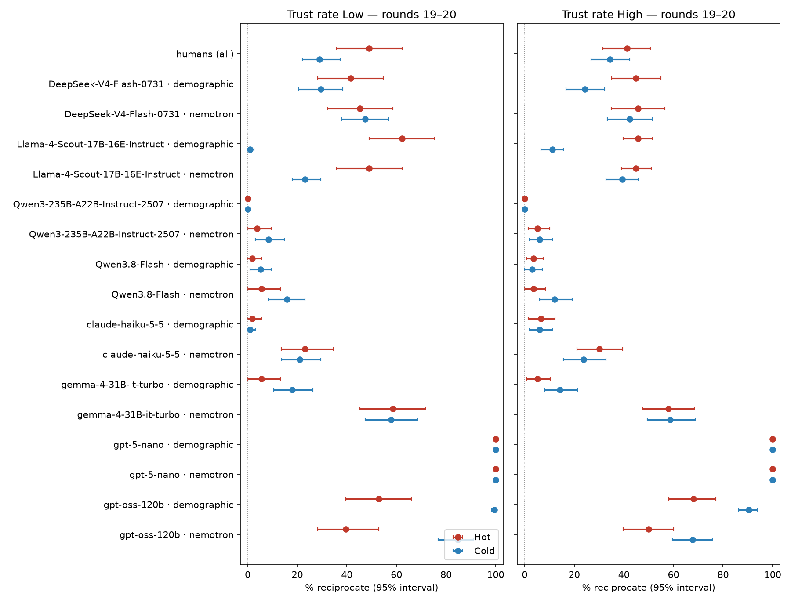

# Results

Theory (payoff-maximising second mover, paper Sec. 2): 0% in every cell. Surprise model: Hot ≥ Cold, gap larger in Low than in High. Only agents that completed the original screens are analysed. 'paired humans' = the real participants paired with exactly those agents, in the same rounds.

## 1. Reciprocation rate (%) by treatment, 95% interval resampling agents

| source                                                       | window       | Hot-Low       | Cold-Low      | Hot-High      | Cold-High     |
|:-------------------------------------------------------------|:-------------|:--------------|:--------------|:--------------|:--------------|
| humans (all)                                                 | round 1      | 51 [42–61]    | 48 [39–58]    | 49 [39–59]    | 48 [38–59]    |
| humans (all)                                                 | rounds 19-20 | 49 [36–62]    | 29 [22–37]    | 41 [32–51]    | 34 [27–42]    |
| humans (all)                                                 | rounds 1-20  | 45 [37–52]    | 38 [32–44]    | 45 [38–52]    | 40 [33–47]    |
| DeepSeek-V4-Flash-0731 · demographic                         | round 1      | 32 [23–41]    | 34 [23–43]    | 51 [41–61]    | 29 [21–37]    |
| DeepSeek-V4-Flash-0731 · demographic                         | rounds 19-20 | 42 [28–55]    | 29 [21–38]    | 45 [35–55]    | 24 [17–32]    |
| DeepSeek-V4-Flash-0731 · demographic                         | rounds 1-20  | 33 [26–41]    | 29 [20–38]    | 46 [38–55]    | 24 [17–32]    |
| DeepSeek-V4-Flash-0731 · demographic · paired humans         | round 1      | 51 [42–61]    | 48 [39–58]    | 49 [39–59]    | 48 [38–59]    |
| DeepSeek-V4-Flash-0731 · demographic · paired humans         | rounds 19-20 | 49 [36–62]    | 29 [22–37]    | 41 [32–51]    | 34 [27–42]    |
| DeepSeek-V4-Flash-0731 · demographic · paired humans         | rounds 1-20  | 45 [37–52]    | 38 [32–44]    | 45 [38–52]    | 40 [33–47]    |
| DeepSeek-V4-Flash-0731 · nemotron                            | round 1      | 45 [35–54]    | 53 [43–63]    | 46 [37–56]    | 45 [36–55]    |
| DeepSeek-V4-Flash-0731 · nemotron                            | rounds 19-20 | 45 [32–58]    | 47 [38–57]    | 46 [35–57]    | 42 [33–52]    |
| DeepSeek-V4-Flash-0731 · nemotron                            | rounds 1-20  | 44 [35–52]    | 48 [39–57]    | 48 [39–57]    | 43 [34–51]    |
| DeepSeek-V4-Flash-0731 · nemotron · paired humans            | round 1      | 51 [42–61]    | 48 [39–58]    | 49 [39–59]    | 48 [38–59]    |
| DeepSeek-V4-Flash-0731 · nemotron · paired humans            | rounds 19-20 | 49 [36–62]    | 29 [22–37]    | 41 [32–51]    | 34 [27–42]    |
| DeepSeek-V4-Flash-0731 · nemotron · paired humans            | rounds 1-20  | 45 [37–52]    | 38 [32–44]    | 45 [38–52]    | 40 [33–47]    |
| Llama-4-Scout-17B-16E-Instruct · demographic                 | round 1      | 2 [0–5]       | 0 [0–0]       | 6 [2–11]      | 7 [3–13]      |
| Llama-4-Scout-17B-16E-Instruct · demographic                 | rounds 19-20 | 62 [49–75]    | 1 [0–3]       | 46 [40–52]    | 11 [7–16]     |
| Llama-4-Scout-17B-16E-Instruct · demographic                 | rounds 1-20  | 39 [36–43]    | 1 [0–3]       | 44 [41–47]    | 10 [6–15]     |
| Llama-4-Scout-17B-16E-Instruct · demographic · paired humans | round 1      | 51 [42–61]    | 48 [39–58]    | 49 [39–59]    | 48 [38–59]    |
| Llama-4-Scout-17B-16E-Instruct · demographic · paired humans | rounds 19-20 | 49 [36–62]    | 29 [22–37]    | 41 [32–51]    | 34 [27–42]    |
| Llama-4-Scout-17B-16E-Instruct · demographic · paired humans | rounds 1-20  | 45 [37–52]    | 38 [32–44]    | 45 [38–52]    | 40 [33–47]    |
| Llama-4-Scout-17B-16E-Instruct · nemotron                    | round 1      | 9 [4–15]      | 12 [5–18]     | 13 [7–20]     | 23 [16–32]    |
| Llama-4-Scout-17B-16E-Instruct · nemotron                    | rounds 19-20 | 49 [36–62]    | 23 [18–29]    | 45 [39–51]    | 39 [33–46]    |
| Llama-4-Scout-17B-16E-Instruct · nemotron                    | rounds 1-20  | 40 [36–44]    | 22 [17–28]    | 45 [42–49]    | 38 [32–45]    |
| Llama-4-Scout-17B-16E-Instruct · nemotron · paired humans    | round 1      | 51 [42–61]    | 48 [39–58]    | 49 [39–59]    | 48 [38–59]    |
| Llama-4-Scout-17B-16E-Instruct · nemotron · paired humans    | rounds 19-20 | 49 [36–62]    | 29 [22–37]    | 41 [32–51]    | 34 [27–42]    |
| Llama-4-Scout-17B-16E-Instruct · nemotron · paired humans    | rounds 1-20  | 45 [37–52]    | 38 [32–44]    | 45 [38–52]    | 40 [33–47]    |
| Qwen3-235B-A22B-Instruct-2507 · demographic                  | round 1      | 0 [0–0]       | 0 [0–0]       | 0 [0–0]       | 0 [0–0]       |
| Qwen3-235B-A22B-Instruct-2507 · demographic                  | rounds 19-20 | 0 [0–0]       | 0 [0–0]       | 0 [0–0]       | 0 [0–0]       |
| Qwen3-235B-A22B-Instruct-2507 · demographic                  | rounds 1-20  | 0 [0–0]       | 0 [0–0]       | 0 [0–0]       | 0 [0–0]       |
| Qwen3-235B-A22B-Instruct-2507 · demographic · paired humans  | round 1      | 51 [42–61]    | 48 [39–58]    | 49 [39–59]    | 48 [38–59]    |
| Qwen3-235B-A22B-Instruct-2507 · demographic · paired humans  | rounds 19-20 | 49 [36–62]    | 29 [22–37]    | 41 [32–51]    | 34 [27–42]    |
| Qwen3-235B-A22B-Instruct-2507 · demographic · paired humans  | rounds 1-20  | 45 [37–52]    | 38 [32–44]    | 45 [38–52]    | 40 [33–47]    |
| Qwen3-235B-A22B-Instruct-2507 · nemotron                     | round 1      | 8 [3–14]      | 8 [3–15]      | 6 [2–11]      | 6 [2–11]      |
| Qwen3-235B-A22B-Instruct-2507 · nemotron                     | rounds 19-20 | 4 [0–9]       | 8 [3–15]      | 5 [1–10]      | 6 [2–11]      |
| Qwen3-235B-A22B-Instruct-2507 · nemotron                     | rounds 1-20  | 7 [3–13]      | 8 [3–15]      | 6 [2–11]      | 6 [2–11]      |
| Qwen3-235B-A22B-Instruct-2507 · nemotron · paired humans     | round 1      | 51 [42–61]    | 48 [39–58]    | 49 [39–59]    | 48 [38–59]    |
| Qwen3-235B-A22B-Instruct-2507 · nemotron · paired humans     | rounds 19-20 | 49 [36–62]    | 29 [22–37]    | 41 [32–51]    | 34 [27–42]    |
| Qwen3-235B-A22B-Instruct-2507 · nemotron · paired humans     | rounds 1-20  | 45 [37–52]    | 38 [32–44]    | 45 [38–52]    | 40 [33–47]    |
| Qwen3.8-Flash · demographic                                  | round 1      | 6 [2–11]      | 5 [1–9]       | 10 [5–16]     | 4 [1–8]       |
| Qwen3.8-Flash · demographic                                  | rounds 19-20 | 2 [0–6]       | 5 [1–9]       | 4 [1–7]       | 3 [0–7]       |
| Qwen3.8-Flash · demographic                                  | rounds 1-20  | 4 [1–8]       | 5 [1–9]       | 4 [1–9]       | 3 [0–7]       |
| Qwen3.8-Flash · demographic · paired humans                  | round 1      | 51 [42–61]    | 48 [39–58]    | 49 [39–59]    | 48 [38–59]    |
| Qwen3.8-Flash · demographic · paired humans                  | rounds 19-20 | 49 [36–62]    | 29 [22–37]    | 41 [32–51]    | 34 [27–42]    |
| Qwen3.8-Flash · demographic · paired humans                  | rounds 1-20  | 45 [37–52]    | 38 [32–44]    | 45 [38–52]    | 40 [33–47]    |
| Qwen3.8-Flash · nemotron                                     | round 1      | 8 [3–14]      | 16 [8–23]     | 4 [1–8]       | 12 [6–19]     |
| Qwen3.8-Flash · nemotron                                     | rounds 19-20 | 6 [0–13]      | 16 [8–23]     | 4 [0–8]       | 12 [6–19]     |
| Qwen3.8-Flash · nemotron                                     | rounds 1-20  | 8 [3–13]      | 16 [8–23]     | 3 [0–7]       | 12 [6–19]     |
| Qwen3.8-Flash · nemotron · paired humans                     | round 1      | 51 [42–61]    | 48 [39–58]    | 49 [39–59]    | 48 [38–59]    |
| Qwen3.8-Flash · nemotron · paired humans                     | rounds 19-20 | 49 [36–62]    | 29 [22–37]    | 41 [32–51]    | 34 [27–42]    |
| Qwen3.8-Flash · nemotron · paired humans                     | rounds 1-20  | 45 [37–52]    | 38 [32–44]    | 45 [38–52]    | 40 [33–47]    |
| claude-haiku-5-5 · demographic                               | round 1      | 1 [0–3]       | 0 [0–0]       | 6 [2–11]      | 0 [0–0]       |
| claude-haiku-5-5 · demographic                               | rounds 19-20 | 2 [0–6]       | 1 [0–3]       | 7 [1–12]      | 6 [2–11]      |
| claude-haiku-5-5 · demographic                               | rounds 1-20  | 1 [0–2]       | 1 [0–3]       | 5 [2–10]      | 6 [2–10]      |
| claude-haiku-5-5 · demographic · paired humans               | round 1      | 51 [42–61]    | 48 [39–58]    | 49 [39–59]    | 48 [38–59]    |
| claude-haiku-5-5 · demographic · paired humans               | rounds 19-20 | 49 [36–62]    | 29 [22–37]    | 41 [32–51]    | 34 [27–42]    |
| claude-haiku-5-5 · demographic · paired humans               | rounds 1-20  | 45 [37–52]    | 38 [32–44]    | 45 [38–52]    | 40 [33–47]    |
| claude-haiku-5-5 · nemotron                                  | round 1      | 24 [16–32]    | 5 [1–11]      | 27 [18–36]    | 3 [0–7]       |
| claude-haiku-5-5 · nemotron                                  | rounds 19-20 | 23 [13–35]    | 21 [14–29]    | 30 [21–39]    | 24 [16–33]    |
| claude-haiku-5-5 · nemotron                                  | rounds 1-20  | 20 [13–28]    | 20 [13–28]    | 33 [25–41]    | 22 [15–31]    |
| claude-haiku-5-5 · nemotron · paired humans                  | round 1      | 53 [43–62]    | 48 [39–58]    | 50 [40–59]    | 48 [38–59]    |
| claude-haiku-5-5 · nemotron · paired humans                  | rounds 19-20 | 50 [37–63]    | 29 [22–37]    | 42 [32–52]    | 34 [27–42]    |
| claude-haiku-5-5 · nemotron · paired humans                  | rounds 1-20  | 46 [39–54]    | 38 [32–44]    | 45 [38–53]    | 40 [33–47]    |
| gemma-4-31B-it-turbo · demographic                           | round 1      | 5 [1–10]      | 18 [11–26]    | 4 [1–8]       | 14 [8–21]     |
| gemma-4-31B-it-turbo · demographic                           | rounds 19-20 | 6 [0–13]      | 18 [11–26]    | 5 [1–10]      | 14 [8–21]     |
| gemma-4-31B-it-turbo · demographic                           | rounds 1-20  | 5 [1–10]      | 18 [11–26]    | 4 [1–8]       | 14 [8–21]     |
| gemma-4-31B-it-turbo · demographic · paired humans           | round 1      | 51 [42–61]    | 48 [39–58]    | 49 [39–59]    | 48 [38–59]    |
| gemma-4-31B-it-turbo · demographic · paired humans           | rounds 19-20 | 49 [36–62]    | 29 [22–37]    | 41 [32–51]    | 34 [27–42]    |
| gemma-4-31B-it-turbo · demographic · paired humans           | rounds 1-20  | 45 [37–52]    | 38 [32–44]    | 45 [38–52]    | 40 [33–47]    |
| gemma-4-31B-it-turbo · nemotron                              | round 1      | 60 [50–70]    | 58 [47–68]    | 61 [52–71]    | 59 [49–69]    |
| gemma-4-31B-it-turbo · nemotron                              | rounds 19-20 | 58 [45–72]    | 58 [47–68]    | 58 [48–68]    | 59 [49–69]    |
| gemma-4-31B-it-turbo · nemotron                              | rounds 1-20  | 60 [49–69]    | 58 [47–68]    | 61 [51–71]    | 59 [49–69]    |
| gemma-4-31B-it-turbo · nemotron · paired humans              | round 1      | 51 [42–61]    | 48 [39–58]    | 49 [39–59]    | 48 [38–59]    |
| gemma-4-31B-it-turbo · nemotron · paired humans              | rounds 19-20 | 49 [36–62]    | 29 [22–37]    | 41 [32–51]    | 34 [27–42]    |
| gemma-4-31B-it-turbo · nemotron · paired humans              | rounds 1-20  | 45 [37–52]    | 38 [32–44]    | 45 [38–52]    | 40 [33–47]    |
| gpt-5-nano · demographic                                     | round 1      | 100 [100–100] | 100 [100–100] | 100 [100–100] | 100 [100–100] |
| gpt-5-nano · demographic                                     | rounds 19-20 | 100 [100–100] | 100 [100–100] | 100 [100–100] | 100 [100–100] |
| gpt-5-nano · demographic                                     | rounds 1-20  | 100 [100–100] | 100 [99–100]  | 100 [100–100] | 99 [99–100]   |
| gpt-5-nano · demographic · paired humans                     | round 1      | 67 [0–100]    | 49 [38–60]    | 0 [0–0]       | 49 [38–58]    |
| gpt-5-nano · demographic · paired humans                     | rounds 19-20 | 100 [100–100] | 29 [22–38]    | 0 [0–0]       | 35 [28–42]    |
| gpt-5-nano · demographic · paired humans                     | rounds 1-20  | 65 [0–100]    | 38 [32–44]    | 0 [0–0]       | 40 [34–47]    |
| gpt-5-nano · nemotron                                        | round 1      | 100 [100–100] | 100 [100–100] | 100 [100–100] | 100 [100–100] |
| gpt-5-nano · nemotron                                        | rounds 19-20 | 100 [100–100] | 100 [100–100] | 100 [100–100] | 100 [100–100] |
| gpt-5-nano · nemotron                                        | rounds 1-20  | 100 [100–100] | 99 [98–100]   | 100 [100–100] | 98 [97–99]    |
| gpt-5-nano · nemotron · paired humans                        | round 1      | 80 [40–100]   | 48 [39–58]    | 100 [100–100] | 49 [39–60]    |
| gpt-5-nano · nemotron · paired humans                        | rounds 19-20 | 100 [100–100] | 29 [21–37]    | 100 [100–100] | 35 [27–42]    |
| gpt-5-nano · nemotron · paired humans                        | rounds 1-20  | 48 [19–77]    | 38 [32–44]    | 89 [79–100]   | 40 [34–47]    |
| gpt-oss-120b · demographic                                   | round 1      | 47 [37–56]    | 98 [95–100]   | 28 [20–37]    | 99 [97–100]   |
| gpt-oss-120b · demographic                                   | rounds 19-20 | 53 [40–66]    | 99 [98–100]   | 68 [58–77]    | 90 [86–94]    |
| gpt-oss-120b · demographic                                   | rounds 1-20  | 52 [44–60]    | 93 [91–95]    | 54 [46–61]    | 67 [64–70]    |
| gpt-oss-120b · demographic · paired humans                   | round 1      | 51 [42–61]    | 48 [39–58]    | 49 [39–59]    | 48 [38–59]    |
| gpt-oss-120b · demographic · paired humans                   | rounds 19-20 | 49 [36–62]    | 29 [22–37]    | 41 [32–51]    | 34 [27–42]    |
| gpt-oss-120b · demographic · paired humans                   | rounds 1-20  | 45 [37–52]    | 38 [32–44]    | 45 [38–52]    | 40 [33–47]    |
| gpt-oss-120b · nemotron                                      | round 1      | 34 [24–43]    | 59 [49–69]    | 44 [35–54]    | 59 [49–68]    |
| gpt-oss-120b · nemotron                                      | rounds 19-20 | 40 [28–53]    | 85 [77–91]    | 50 [40–60]    | 68 [60–76]    |
| gpt-oss-120b · nemotron                                      | rounds 1-20  | 38 [30–47]    | 76 [69–82]    | 50 [41–58]    | 56 [49–62]    |
| gpt-oss-120b · nemotron · paired humans                      | round 1      | 51 [42–61]    | 48 [39–58]    | 49 [39–59]    | 48 [38–59]    |
| gpt-oss-120b · nemotron · paired humans                      | rounds 19-20 | 49 [36–62]    | 29 [22–37]    | 41 [32–51]    | 34 [27–42]    |
| gpt-oss-120b · nemotron · paired humans                      | rounds 1-20  | 45 [37–52]    | 38 [32–44]    | 45 [38–52]    | 40 [33–47]    |

## 2. Hot − Cold gap, rounds 19-20 (the paper's main window), 95% intervals

| source                                                       | agents per cell (HL/CL/HH/CH)   | gap Low (pp)   | gap High (pp)   | gap Low − gap High (pp)   | verdict                               |
|:-------------------------------------------------------------|:--------------------------------|:---------------|:----------------|:--------------------------|:--------------------------------------|
| humans (all)                                                 | 53/95/94/99                     | +20 [+6, +35]  | +7 [-5, +19]    | +13 [-6, +33]             | as in the paper: Hot > Cold in Low    |
| DeepSeek-V4-Flash-0731 · demographic                         | 53/95/94/99                     | +12 [-3, +28]  | +21 [+7, +33]   | -9 [-29, +12]             | cannot tell                           |
| DeepSeek-V4-Flash-0731 · demographic · paired humans         | 53/95/94/99                     | +20 [+6, +35]  | +7 [-5, +19]    | +13 [-6, +33]             | as in the paper: Hot > Cold in Low    |
| DeepSeek-V4-Flash-0731 · nemotron                            | 53/95/94/99                     | -2 [-19, +14]  | +3 [-11, +17]   | -5 [-25, +16]             | cannot tell                           |
| DeepSeek-V4-Flash-0731 · nemotron · paired humans            | 53/95/94/99                     | +20 [+6, +35]  | +7 [-5, +19]    | +13 [-6, +33]             | as in the paper: Hot > Cold in Low    |
| Llama-4-Scout-17B-16E-Instruct · demographic                 | 53/95/94/99                     | +61 [+47, +75] | +35 [+27, +42]  | +27 [+10, +43]            | as in the paper: Hot > Cold in Low    |
| Llama-4-Scout-17B-16E-Instruct · demographic · paired humans | 53/95/94/99                     | +20 [+6, +35]  | +7 [-5, +19]    | +13 [-6, +33]             | as in the paper: Hot > Cold in Low    |
| Llama-4-Scout-17B-16E-Instruct · nemotron                    | 53/95/94/99                     | +26 [+11, +41] | +6 [-4, +15]    | +20 [+3, +38]             | as in the paper: Hot > Cold in Low    |
| Llama-4-Scout-17B-16E-Instruct · nemotron · paired humans    | 53/95/94/99                     | +20 [+6, +35]  | +7 [-5, +19]    | +13 [-6, +33]             | as in the paper: Hot > Cold in Low    |
| Qwen3-235B-A22B-Instruct-2507 · demographic                  | 53/95/94/99                     | +0 [+0, +0]    | +0 [+0, +0]     | +0 [+0, +0]               | no variation (always RIGHT)           |
| Qwen3-235B-A22B-Instruct-2507 · demographic · paired humans  | 53/95/94/99                     | +20 [+6, +35]  | +7 [-5, +19]    | +13 [-6, +33]             | as in the paper: Hot > Cold in Low    |
| Qwen3-235B-A22B-Instruct-2507 · nemotron                     | 53/95/94/99                     | -5 [-12, +4]   | -1 [-8, +6]     | -4 [-13, +7]              | cannot tell                           |
| Qwen3-235B-A22B-Instruct-2507 · nemotron · paired humans     | 53/95/94/99                     | +20 [+6, +35]  | +7 [-5, +19]    | +13 [-6, +33]             | as in the paper: Hot > Cold in Low    |
| Qwen3.8-Flash · demographic                                  | 53/95/94/99                     | -3 [-9, +3]    | +1 [-4, +6]     | -4 [-12, +4]              | cannot tell                           |
| Qwen3.8-Flash · demographic · paired humans                  | 53/95/94/99                     | +20 [+6, +35]  | +7 [-5, +19]    | +13 [-6, +33]             | as in the paper: Hot > Cold in Low    |
| Qwen3.8-Flash · nemotron                                     | 53/95/94/99                     | -10 [-20, -0]  | -8 [-16, -1]    | -2 [-15, +11]             | against the paper: Cold > Hot in Low  |
| Qwen3.8-Flash · nemotron · paired humans                     | 53/95/94/99                     | +20 [+6, +35]  | +7 [-5, +19]    | +13 [-6, +33]             | as in the paper: Hot > Cold in Low    |
| claude-haiku-5-5 · demographic                               | 53/95/94/99                     | +1 [-2, +6]    | +0 [-6, +7]     | +0 [-7, +9]               | cannot tell                           |
| claude-haiku-5-5 · demographic · paired humans               | 53/95/94/99                     | +20 [+6, +35]  | +7 [-5, +19]    | +13 [-6, +33]             | as in the paper: Hot > Cold in Low    |
| claude-haiku-5-5 · nemotron                                  | 52/95/93/99                     | +2 [-11, +15]  | +6 [-6, +19]    | -4 [-24, +15]             | cannot tell                           |
| claude-haiku-5-5 · nemotron · paired humans                  | 52/95/93/99                     | +21 [+5, +36]  | +8 [-5, +20]    | +13 [-8, +33]             | as in the paper: Hot > Cold in Low    |
| gemma-4-31B-it-turbo · demographic                           | 53/95/94/99                     | -12 [-22, -1]  | -9 [-18, -1]    | -3 [-16, +10]             | against the paper: Cold > Hot in Low  |
| gemma-4-31B-it-turbo · demographic · paired humans           | 53/95/94/99                     | +20 [+6, +35]  | +7 [-5, +19]    | +13 [-6, +33]             | as in the paper: Hot > Cold in Low    |
| gemma-4-31B-it-turbo · nemotron                              | 53/95/94/99                     | +1 [-16, +17]  | -1 [-14, +15]   | +1 [-19, +23]             | cannot tell                           |
| gemma-4-31B-it-turbo · nemotron · paired humans              | 53/95/94/99                     | +20 [+6, +35]  | +7 [-5, +19]    | +13 [-6, +33]             | as in the paper: Hot > Cold in Low    |
| gpt-5-nano · demographic                                     | 2/94/1/98                       | +0 [+0, +0]    | +0 [+0, +0]     | +0 [+0, +0]               | no variation (always LEFT)            |
| gpt-5-nano · demographic · paired humans                     | 2/94/1/98                       | +71 [+63, +78] | -35 [-42, -27]  | +105 [+94, +116]          | cell under 30 agents: not interpreted |
| gpt-5-nano · nemotron                                        | 2/93/2/97                       | +0 [+0, +0]    | +0 [+0, +0]     | +0 [+0, +0]               | no variation (always LEFT)            |
| gpt-5-nano · nemotron · paired humans                        | 2/93/2/97                       | +71 [+62, +78] | +65 [+58, +73]  | +6 [-6, +16]              | cell under 30 agents: not interpreted |
| gpt-oss-120b · demographic                                   | 53/95/94/99                     | -47 [-60, -33] | -22 [-33, -12]  | -24 [-42, -6]             | against the paper: Cold > Hot in Low  |
| gpt-oss-120b · demographic · paired humans                   | 53/95/94/99                     | +20 [+6, +35]  | +7 [-5, +19]    | +13 [-6, +33]             | as in the paper: Hot > Cold in Low    |
| gpt-oss-120b · nemotron                                      | 53/95/94/99                     | -45 [-60, -30] | -18 [-30, -4]   | -27 [-48, -8]             | against the paper: Cold > Hot in Low  |
| gpt-oss-120b · nemotron · paired humans                      | 53/95/94/99                     | +20 [+6, +35]  | +7 [-5, +19]    | +13 [-6, +33]             | as in the paper: Hot > Cold in Low    |

## 3. Distribution of agents: never / sometimes / always reciprocate

| source                                                       |   agents |   never % |   sometimes % |   always % |
|:-------------------------------------------------------------|---------:|----------:|--------------:|-----------:|
| humans (all)                                                 |      396 |        24 |            62 |         14 |
| DeepSeek-V4-Flash-0731 · demographic                         |      396 |        54 |            22 |         23 |
| DeepSeek-V4-Flash-0731 · demographic · paired humans         |      396 |        24 |            62 |         14 |
| DeepSeek-V4-Flash-0731 · nemotron                            |      396 |        44 |            21 |         35 |
| DeepSeek-V4-Flash-0731 · nemotron · paired humans            |      396 |        24 |            62 |         14 |
| Llama-4-Scout-17B-16E-Instruct · demographic                 |      396 |        49 |            50 |          1 |
| Llama-4-Scout-17B-16E-Instruct · demographic · paired humans |      396 |        24 |            62 |         14 |
| Llama-4-Scout-17B-16E-Instruct · nemotron                    |      396 |        29 |            66 |          5 |
| Llama-4-Scout-17B-16E-Instruct · nemotron · paired humans    |      396 |        24 |            62 |         14 |
| Qwen3-235B-A22B-Instruct-2507 · demographic                  |      396 |       100 |             0 |          0 |
| Qwen3-235B-A22B-Instruct-2507 · demographic · paired humans  |      396 |        24 |            62 |         14 |
| Qwen3-235B-A22B-Instruct-2507 · nemotron                     |      396 |        93 |             0 |          7 |
| Qwen3-235B-A22B-Instruct-2507 · nemotron · paired humans     |      396 |        24 |            62 |         14 |
| Qwen3.8-Flash · demographic                                  |      396 |        94 |             2 |          4 |
| Qwen3.8-Flash · demographic · paired humans                  |      396 |        24 |            62 |         14 |
| Qwen3.8-Flash · nemotron                                     |      396 |        90 |             1 |         10 |
| Qwen3.8-Flash · nemotron · paired humans                     |      396 |        24 |            62 |         14 |
| claude-haiku-5-5 · demographic                               |      396 |        93 |             7 |          1 |
| claude-haiku-5-5 · demographic · paired humans               |      396 |        24 |            62 |         14 |
| claude-haiku-5-5 · nemotron                                  |      392 |        68 |            23 |          9 |
| claude-haiku-5-5 · nemotron · paired humans                  |      392 |        23 |            62 |         14 |
| gemma-4-31B-it-turbo · demographic                           |      396 |        90 |             0 |         10 |
| gemma-4-31B-it-turbo · demographic · paired humans           |      396 |        24 |            62 |         14 |
| gemma-4-31B-it-turbo · nemotron                              |      396 |        41 |             0 |         59 |
| gemma-4-31B-it-turbo · nemotron · paired humans              |      396 |        24 |            62 |         14 |
| gpt-5-nano · demographic                                     |      196 |         0 |             5 |         95 |
| gpt-5-nano · demographic · paired humans                     |      196 |        19 |            71 |         10 |
| gpt-5-nano · nemotron                                        |      197 |         0 |            15 |         85 |
| gpt-5-nano · nemotron · paired humans                        |      197 |        18 |            73 |         10 |
| gpt-oss-120b · demographic                                   |      396 |        16 |            59 |         26 |
| gpt-oss-120b · demographic · paired humans                   |      396 |        24 |            62 |         14 |
| gpt-oss-120b · nemotron                                      |      396 |        31 |            39 |         30 |
| gpt-oss-120b · nemotron · paired humans                      |      396 |        24 |            62 |         14 |

## 4. Reciprocation by blocks of rounds (%), Hot vs Cold

| source                                                       | mode   |   1-5 |   6-10 |   11-15 |   16-20 |
|:-------------------------------------------------------------|:-------|------:|-------:|--------:|--------:|
| humans (all)                                                 | Hot    |    48 |     44 |      44 |      45 |
| humans (all)                                                 | Cold   |    44 |     39 |      37 |      35 |
| DeepSeek-V4-Flash-0731 · demographic                         | Hot    |    43 |     42 |      41 |      43 |
| DeepSeek-V4-Flash-0731 · demographic                         | Cold   |    29 |     27 |      26 |      26 |
| DeepSeek-V4-Flash-0731 · demographic · paired humans         | Hot    |    48 |     44 |      44 |      45 |
| DeepSeek-V4-Flash-0731 · demographic · paired humans         | Cold   |    44 |     39 |      37 |      35 |
| DeepSeek-V4-Flash-0731 · nemotron                            | Hot    |    45 |     49 |      48 |      46 |
| DeepSeek-V4-Flash-0731 · nemotron                            | Cold   |    45 |     45 |      45 |      45 |
| DeepSeek-V4-Flash-0731 · nemotron · paired humans            | Hot    |    48 |     44 |      44 |      45 |
| DeepSeek-V4-Flash-0731 · nemotron · paired humans            | Cold   |    44 |     39 |      37 |      35 |
| Llama-4-Scout-17B-16E-Instruct · demographic                 | Hot    |    36 |     40 |      49 |      46 |
| Llama-4-Scout-17B-16E-Instruct · demographic                 | Cold   |     6 |      6 |       6 |       6 |
| Llama-4-Scout-17B-16E-Instruct · demographic · paired humans | Hot    |    48 |     44 |      44 |      45 |
| Llama-4-Scout-17B-16E-Instruct · demographic · paired humans | Cold   |    44 |     39 |      37 |      35 |
| Llama-4-Scout-17B-16E-Instruct · nemotron                    | Hot    |    38 |     44 |      48 |      46 |
| Llama-4-Scout-17B-16E-Instruct · nemotron                    | Cold   |    29 |     32 |      30 |      31 |
| Llama-4-Scout-17B-16E-Instruct · nemotron · paired humans    | Hot    |    48 |     44 |      44 |      45 |
| Llama-4-Scout-17B-16E-Instruct · nemotron · paired humans    | Cold   |    44 |     39 |      37 |      35 |
| Qwen3-235B-A22B-Instruct-2507 · demographic                  | Hot    |     0 |      0 |       0 |       0 |
| Qwen3-235B-A22B-Instruct-2507 · demographic                  | Cold   |     0 |      0 |       0 |       0 |
| Qwen3-235B-A22B-Instruct-2507 · demographic · paired humans  | Hot    |    48 |     44 |      44 |      45 |
| Qwen3-235B-A22B-Instruct-2507 · demographic · paired humans  | Cold   |    44 |     39 |      37 |      35 |
| Qwen3-235B-A22B-Instruct-2507 · nemotron                     | Hot    |     7 |      6 |       7 |       6 |
| Qwen3-235B-A22B-Instruct-2507 · nemotron                     | Cold   |     7 |      7 |       7 |       7 |
| Qwen3-235B-A22B-Instruct-2507 · nemotron · paired humans     | Hot    |    48 |     44 |      44 |      45 |
| Qwen3-235B-A22B-Instruct-2507 · nemotron · paired humans     | Cold   |    44 |     39 |      37 |      35 |
| Qwen3.8-Flash · demographic                                  | Hot    |     5 |      4 |       4 |       4 |
| Qwen3.8-Flash · demographic                                  | Cold   |     4 |      4 |       4 |       4 |
| Qwen3.8-Flash · demographic · paired humans                  | Hot    |    48 |     44 |      44 |      45 |
| Qwen3.8-Flash · demographic · paired humans                  | Cold   |    44 |     39 |      37 |      35 |
| Qwen3.8-Flash · nemotron                                     | Hot    |     5 |      4 |       4 |       4 |
| Qwen3.8-Flash · nemotron                                     | Cold   |    14 |     14 |      14 |      14 |
| Qwen3.8-Flash · nemotron · paired humans                     | Hot    |    48 |     44 |      44 |      45 |
| Qwen3.8-Flash · nemotron · paired humans                     | Cold   |    44 |     39 |      37 |      35 |
| claude-haiku-5-5 · demographic                               | Hot    |     3 |      4 |       4 |       5 |
| claude-haiku-5-5 · demographic                               | Cold   |     3 |      4 |       4 |       4 |
| claude-haiku-5-5 · demographic · paired humans               | Hot    |    48 |     44 |      44 |      45 |
| claude-haiku-5-5 · demographic · paired humans               | Cold   |    44 |     39 |      37 |      35 |
| claude-haiku-5-5 · nemotron                                  | Hot    |    26 |     30 |      31 |      29 |
| claude-haiku-5-5 · nemotron                                  | Cold   |    17 |     23 |      23 |      23 |
| claude-haiku-5-5 · nemotron · paired humans                  | Hot    |    48 |     44 |      44 |      46 |
| claude-haiku-5-5 · nemotron · paired humans                  | Cold   |    44 |     39 |      37 |      35 |
| gemma-4-31B-it-turbo · demographic                           | Hot    |     5 |      4 |       4 |       5 |
| gemma-4-31B-it-turbo · demographic                           | Cold   |    16 |     16 |      16 |      16 |
| gemma-4-31B-it-turbo · demographic · paired humans           | Hot    |    48 |     44 |      44 |      45 |
| gemma-4-31B-it-turbo · demographic · paired humans           | Cold   |    44 |     39 |      37 |      35 |
| gemma-4-31B-it-turbo · nemotron                              | Hot    |    60 |     61 |      60 |      61 |
| gemma-4-31B-it-turbo · nemotron                              | Cold   |    58 |     58 |      58 |      58 |
| gemma-4-31B-it-turbo · nemotron · paired humans              | Hot    |    48 |     44 |      44 |      45 |
| gemma-4-31B-it-turbo · nemotron · paired humans              | Cold   |    44 |     39 |      37 |      35 |
| gpt-5-nano · demographic                                     | Hot    |   100 |    100 |     100 |     100 |
| gpt-5-nano · demographic                                     | Cold   |    99 |     99 |     100 |     100 |
| gpt-5-nano · demographic · paired humans                     | Hot    |    44 |     25 |      43 |      29 |
| gpt-5-nano · demographic · paired humans                     | Cold   |    45 |     39 |      38 |      35 |
| gpt-5-nano · nemotron                                        | Hot    |   100 |    100 |     100 |     100 |
| gpt-5-nano · nemotron                                        | Cold   |    96 |     99 |     100 |     100 |
| gpt-5-nano · nemotron · paired humans                        | Hot    |    65 |     83 |      62 |      70 |
| gpt-5-nano · nemotron · paired humans                        | Cold   |    45 |     39 |      37 |      35 |
| gpt-oss-120b · demographic                                   | Hot    |    45 |     48 |      57 |      63 |
| gpt-oss-120b · demographic                                   | Cold   |    73 |     75 |      84 |      87 |
| gpt-oss-120b · demographic · paired humans                   | Hot    |    48 |     44 |      44 |      45 |
| gpt-oss-120b · demographic · paired humans                   | Cold   |    44 |     39 |      37 |      35 |
| gpt-oss-120b · nemotron                                      | Hot    |    44 |     45 |      49 |      47 |
| gpt-oss-120b · nemotron                                      | Cold   |    58 |     64 |      69 |      72 |
| gpt-oss-120b · nemotron · paired humans                      | Hot    |    48 |     44 |      44 |      45 |
| gpt-oss-120b · nemotron · paired humans                      | Cold   |    44 |     39 |      37 |      35 |

## 5. Paper's Table 2 (LPM, controls age, female, education; clustered SE)

| source                                                       | window       | spec       |    n | Hot            | Hot×High       |
|:-------------------------------------------------------------|:-------------|:-----------|-----:|:---------------|:---------------|
| humans (all)                                                 | round 1      | Hot + High |  395 | 0.005 (0.050)  |                |
| humans (all)                                                 | round 1      | Hot×High   |  395 | 0.010 (0.071)  | -0.011 (0.100) |
| humans (all)                                                 | rounds 19-20 | Hot + High |  579 | 0.103 (0.049)  |                |
| humans (all)                                                 | rounds 19-20 | Hot×High   |  579 | 0.177 (0.081)  | -0.112 (0.102) |
| humans (all)                                                 | rounds 1-20  | Hot + High | 5815 | 0.056 (0.036)  |                |
| humans (all)                                                 | rounds 1-20  | Hot×High   | 5815 | 0.065 (0.048)  | -0.014 (0.069) |
| DeepSeek-V4-Flash-0731 · demographic                         | round 1      | Hot + High |  395 | 0.101 (0.049)  |                |
| DeepSeek-V4-Flash-0731 · demographic                         | round 1      | Hot×High   |  395 | -0.022 (0.069) | 0.245 (0.096)  |
| DeepSeek-V4-Flash-0731 · demographic                         | rounds 19-20 | Hot + High |  579 | 0.178 (0.053)  |                |
| DeepSeek-V4-Flash-0731 · demographic                         | rounds 19-20 | Hot×High   |  579 | 0.110 (0.083)  | 0.102 (0.105)  |
| DeepSeek-V4-Flash-0731 · demographic                         | rounds 1-20  | Hot + High | 5815 | 0.154 (0.045)  |                |
| DeepSeek-V4-Flash-0731 · demographic                         | rounds 1-20  | Hot×High   | 5815 | 0.029 (0.062)  | 0.192 (0.084)  |
| DeepSeek-V4-Flash-0731 · demographic · paired humans         | round 1      | Hot + High |  395 | 0.005 (0.050)  |                |
| DeepSeek-V4-Flash-0731 · demographic · paired humans         | round 1      | Hot×High   |  395 | 0.010 (0.071)  | -0.011 (0.100) |
| DeepSeek-V4-Flash-0731 · demographic · paired humans         | rounds 19-20 | Hot + High |  579 | 0.103 (0.049)  |                |
| DeepSeek-V4-Flash-0731 · demographic · paired humans         | rounds 19-20 | Hot×High   |  579 | 0.177 (0.081)  | -0.112 (0.102) |
| DeepSeek-V4-Flash-0731 · demographic · paired humans         | rounds 1-20  | Hot + High | 5815 | 0.056 (0.036)  |                |
| DeepSeek-V4-Flash-0731 · demographic · paired humans         | rounds 1-20  | Hot×High   | 5815 | 0.065 (0.048)  | -0.014 (0.069) |
| DeepSeek-V4-Flash-0731 · nemotron                            | round 1      | Hot + High |  395 | -0.036 (0.051) |                |
| DeepSeek-V4-Flash-0731 · nemotron                            | round 1      | Hot×High   |  395 | -0.069 (0.072) | 0.065 (0.100)  |
| DeepSeek-V4-Flash-0731 · nemotron                            | rounds 19-20 | Hot + High |  579 | 0.009 (0.056)  |                |
| DeepSeek-V4-Flash-0731 · nemotron                            | rounds 19-20 | Hot×High   |  579 | -0.005 (0.085) | 0.022 (0.111)  |
| DeepSeek-V4-Flash-0731 · nemotron                            | rounds 1-20  | Hot + High | 5815 | 0.012 (0.050)  |                |
| DeepSeek-V4-Flash-0731 · nemotron                            | rounds 1-20  | Hot×High   | 5815 | -0.039 (0.066) | 0.080 (0.093)  |
| DeepSeek-V4-Flash-0731 · nemotron · paired humans            | round 1      | Hot + High |  395 | 0.005 (0.050)  |                |
| DeepSeek-V4-Flash-0731 · nemotron · paired humans            | round 1      | Hot×High   |  395 | 0.010 (0.071)  | -0.011 (0.100) |
| DeepSeek-V4-Flash-0731 · nemotron · paired humans            | rounds 19-20 | Hot + High |  579 | 0.103 (0.049)  |                |
| DeepSeek-V4-Flash-0731 · nemotron · paired humans            | rounds 19-20 | Hot×High   |  579 | 0.177 (0.081)  | -0.112 (0.102) |
| DeepSeek-V4-Flash-0731 · nemotron · paired humans            | rounds 1-20  | Hot + High | 5815 | 0.056 (0.036)  |                |
| DeepSeek-V4-Flash-0731 · nemotron · paired humans            | rounds 1-20  | Hot×High   | 5815 | 0.065 (0.048)  | -0.014 (0.069) |
| Llama-4-Scout-17B-16E-Instruct · demographic                 | round 1      | Hot + High |  395 | 0.001 (0.019)  |                |
| Llama-4-Scout-17B-16E-Instruct · demographic                 | round 1      | Hot×High   |  395 | 0.014 (0.027)  | -0.024 (0.038) |
| Llama-4-Scout-17B-16E-Instruct · demographic                 | rounds 19-20 | Hot + High |  579 | 0.429 (0.036)  |                |
| Llama-4-Scout-17B-16E-Instruct · demographic                 | rounds 19-20 | Hot×High   |  579 | 0.605 (0.068)  | -0.265 (0.078) |
| Llama-4-Scout-17B-16E-Instruct · demographic                 | rounds 1-20  | Hot + High | 5815 | 0.353 (0.018)  |                |
| Llama-4-Scout-17B-16E-Instruct · demographic                 | rounds 1-20  | Hot×High   | 5815 | 0.379 (0.020)  | -0.041 (0.032) |
| Llama-4-Scout-17B-16E-Instruct · demographic · paired humans | round 1      | Hot + High |  395 | 0.005 (0.050)  |                |
| Llama-4-Scout-17B-16E-Instruct · demographic · paired humans | round 1      | Hot×High   |  395 | 0.010 (0.071)  | -0.011 (0.100) |
| Llama-4-Scout-17B-16E-Instruct · demographic · paired humans | rounds 19-20 | Hot + High |  579 | 0.103 (0.049)  |                |
| Llama-4-Scout-17B-16E-Instruct · demographic · paired humans | rounds 19-20 | Hot×High   |  579 | 0.177 (0.081)  | -0.112 (0.102) |
| Llama-4-Scout-17B-16E-Instruct · demographic · paired humans | rounds 1-20  | Hot + High | 5815 | 0.056 (0.036)  |                |
| Llama-4-Scout-17B-16E-Instruct · demographic · paired humans | rounds 1-20  | Hot×High   | 5815 | 0.065 (0.048)  | -0.014 (0.069) |
| Llama-4-Scout-17B-16E-Instruct · nemotron                    | round 1      | Hot + High |  395 | -0.078 (0.035) |                |
| Llama-4-Scout-17B-16E-Instruct · nemotron                    | round 1      | Hot×High   |  395 | -0.038 (0.050) | -0.080 (0.070) |
| Llama-4-Scout-17B-16E-Instruct · nemotron                    | rounds 19-20 | Hot + High |  579 | 0.104 (0.042)  |                |
| Llama-4-Scout-17B-16E-Instruct · nemotron                    | rounds 19-20 | Hot×High   |  579 | 0.236 (0.076)  | -0.199 (0.090) |
| Llama-4-Scout-17B-16E-Instruct · nemotron                    | rounds 1-20  | Hot + High | 5815 | 0.093 (0.029)  |                |
| Llama-4-Scout-17B-16E-Instruct · nemotron                    | rounds 1-20  | Hot×High   | 5815 | 0.160 (0.036)  | -0.104 (0.052) |
| Llama-4-Scout-17B-16E-Instruct · nemotron · paired humans    | round 1      | Hot + High |  395 | 0.005 (0.050)  |                |
| Llama-4-Scout-17B-16E-Instruct · nemotron · paired humans    | round 1      | Hot×High   |  395 | 0.010 (0.071)  | -0.011 (0.100) |
| Llama-4-Scout-17B-16E-Instruct · nemotron · paired humans    | rounds 19-20 | Hot + High |  579 | 0.103 (0.049)  |                |
| Llama-4-Scout-17B-16E-Instruct · nemotron · paired humans    | rounds 19-20 | Hot×High   |  579 | 0.177 (0.081)  | -0.112 (0.102) |
| Llama-4-Scout-17B-16E-Instruct · nemotron · paired humans    | rounds 1-20  | Hot + High | 5815 | 0.056 (0.036)  |                |
| Llama-4-Scout-17B-16E-Instruct · nemotron · paired humans    | rounds 1-20  | Hot×High   | 5815 | 0.065 (0.048)  | -0.014 (0.069) |
| Qwen3-235B-A22B-Instruct-2507 · demographic                  | round 1      | Hot + High |  396 | —              | —              |
| Qwen3-235B-A22B-Instruct-2507 · demographic                  | round 1      | Hot×High   |  396 | —              | —              |
| Qwen3-235B-A22B-Instruct-2507 · demographic                  | rounds 19-20 | Hot + High |  579 | —              | —              |
| Qwen3-235B-A22B-Instruct-2507 · demographic                  | rounds 19-20 | Hot×High   |  579 | —              | —              |
| Qwen3-235B-A22B-Instruct-2507 · demographic                  | rounds 1-20  | Hot + High | 5821 | —              | —              |
| Qwen3-235B-A22B-Instruct-2507 · demographic                  | rounds 1-20  | Hot×High   | 5821 | —              | —              |
| Qwen3-235B-A22B-Instruct-2507 · demographic · paired humans  | round 1      | Hot + High |  395 | 0.005 (0.050)  |                |
| Qwen3-235B-A22B-Instruct-2507 · demographic · paired humans  | round 1      | Hot×High   |  395 | 0.010 (0.071)  | -0.011 (0.100) |
| Qwen3-235B-A22B-Instruct-2507 · demographic · paired humans  | rounds 19-20 | Hot + High |  579 | 0.103 (0.049)  |                |
| Qwen3-235B-A22B-Instruct-2507 · demographic · paired humans  | rounds 19-20 | Hot×High   |  579 | 0.177 (0.081)  | -0.112 (0.102) |
| Qwen3-235B-A22B-Instruct-2507 · demographic · paired humans  | rounds 1-20  | Hot + High | 5815 | 0.056 (0.036)  |                |
| Qwen3-235B-A22B-Instruct-2507 · demographic · paired humans  | rounds 1-20  | Hot×High   | 5815 | 0.065 (0.048)  | -0.014 (0.069) |
| Qwen3-235B-A22B-Instruct-2507 · nemotron                     | round 1      | Hot + High |  395 | -0.002 (0.026) |                |
| Qwen3-235B-A22B-Instruct-2507 · nemotron                     | round 1      | Hot×High   |  395 | -0.005 (0.037) | 0.005 (0.052)  |
| Qwen3-235B-A22B-Instruct-2507 · nemotron                     | rounds 19-20 | Hot + High |  579 | -0.025 (0.028) |                |
| Qwen3-235B-A22B-Instruct-2507 · nemotron                     | rounds 19-20 | Hot×High   |  579 | -0.055 (0.039) | 0.045 (0.052)  |
| Qwen3-235B-A22B-Instruct-2507 · nemotron                     | rounds 1-20  | Hot + High | 5815 | -0.005 (0.027) |                |
| Qwen3-235B-A22B-Instruct-2507 · nemotron                     | rounds 1-20  | Hot×High   | 5815 | -0.012 (0.038) | 0.012 (0.051)  |
| Qwen3-235B-A22B-Instruct-2507 · nemotron · paired humans     | round 1      | Hot + High |  395 | 0.005 (0.050)  |                |
| Qwen3-235B-A22B-Instruct-2507 · nemotron · paired humans     | round 1      | Hot×High   |  395 | 0.010 (0.071)  | -0.011 (0.100) |
| Qwen3-235B-A22B-Instruct-2507 · nemotron · paired humans     | rounds 19-20 | Hot + High |  579 | 0.103 (0.049)  |                |
| Qwen3-235B-A22B-Instruct-2507 · nemotron · paired humans     | rounds 19-20 | Hot×High   |  579 | 0.177 (0.081)  | -0.112 (0.102) |
| Qwen3-235B-A22B-Instruct-2507 · nemotron · paired humans     | rounds 1-20  | Hot + High | 5815 | 0.056 (0.036)  |                |
| Qwen3-235B-A22B-Instruct-2507 · nemotron · paired humans     | rounds 1-20  | Hot×High   | 5815 | 0.065 (0.048)  | -0.014 (0.069) |
| Qwen3.8-Flash · demographic                                  | round 1      | Hot + High |  395 | 0.036 (0.025)  |                |
| Qwen3.8-Flash · demographic                                  | round 1      | Hot×High   |  395 | 0.009 (0.035)  | 0.053 (0.049)  |
| Qwen3.8-Flash · demographic                                  | rounds 19-20 | Hot + High |  579 | -0.006 (0.021) |                |
| Qwen3.8-Flash · demographic                                  | rounds 19-20 | Hot×High   |  579 | -0.033 (0.029) | 0.040 (0.040)  |
| Qwen3.8-Flash · demographic                                  | rounds 1-20  | Hot + High | 5815 | 0.007 (0.021)  |                |
| Qwen3.8-Flash · demographic                                  | rounds 1-20  | Hot×High   | 5815 | -0.009 (0.029) | 0.024 (0.040)  |
| Qwen3.8-Flash · demographic · paired humans                  | round 1      | Hot + High |  395 | 0.005 (0.050)  |                |
| Qwen3.8-Flash · demographic · paired humans                  | round 1      | Hot×High   |  395 | 0.010 (0.071)  | -0.011 (0.100) |
| Qwen3.8-Flash · demographic · paired humans                  | rounds 19-20 | Hot + High |  579 | 0.103 (0.049)  |                |
| Qwen3.8-Flash · demographic · paired humans                  | rounds 19-20 | Hot×High   |  579 | 0.177 (0.081)  | -0.112 (0.102) |
| Qwen3.8-Flash · demographic · paired humans                  | rounds 1-20  | Hot + High | 5815 | 0.056 (0.036)  |                |
| Qwen3.8-Flash · demographic · paired humans                  | rounds 1-20  | Hot×High   | 5815 | 0.065 (0.048)  | -0.014 (0.069) |
| Qwen3.8-Flash · nemotron                                     | round 1      | Hot + High |  395 | -0.090 (0.030) |                |
| Qwen3.8-Flash · nemotron                                     | round 1      | Hot×High   |  395 | -0.097 (0.042) | 0.014 (0.059)  |
| Qwen3.8-Flash · nemotron                                     | rounds 19-20 | Hot + High |  579 | -0.098 (0.032) |                |
| Qwen3.8-Flash · nemotron                                     | rounds 19-20 | Hot×High   |  579 | -0.122 (0.051) | 0.036 (0.064)  |
| Qwen3.8-Flash · nemotron                                     | rounds 1-20  | Hot + High | 5815 | -0.096 (0.030) |                |
| Qwen3.8-Flash · nemotron                                     | rounds 1-20  | Hot×High   | 5815 | -0.104 (0.045) | 0.012 (0.058)  |
| Qwen3.8-Flash · nemotron · paired humans                     | round 1      | Hot + High |  395 | 0.005 (0.050)  |                |
| Qwen3.8-Flash · nemotron · paired humans                     | round 1      | Hot×High   |  395 | 0.010 (0.071)  | -0.011 (0.100) |
| Qwen3.8-Flash · nemotron · paired humans                     | rounds 19-20 | Hot + High |  579 | 0.103 (0.049)  |                |
| Qwen3.8-Flash · nemotron · paired humans                     | rounds 19-20 | Hot×High   |  579 | 0.177 (0.081)  | -0.112 (0.102) |
| Qwen3.8-Flash · nemotron · paired humans                     | rounds 1-20  | Hot + High | 5815 | 0.056 (0.036)  |                |
| Qwen3.8-Flash · nemotron · paired humans                     | rounds 1-20  | Hot×High   | 5815 | 0.065 (0.048)  | -0.014 (0.069) |
| claude-haiku-5-5 · demographic                               | round 1      | Hot + High |  395 | 0.036 (0.013)  |                |
| claude-haiku-5-5 · demographic                               | round 1      | Hot×High   |  395 | 0.006 (0.018)  | 0.060 (0.026)  |
| claude-haiku-5-5 · demographic                               | rounds 19-20 | Hot + High |  579 | 0.002 (0.027)  |                |
| claude-haiku-5-5 · demographic                               | rounds 19-20 | Hot×High   |  579 | -0.007 (0.021) | 0.014 (0.040)  |
| claude-haiku-5-5 · demographic                               | rounds 1-20  | Hot + High | 5815 | -0.008 (0.021) |                |
| claude-haiku-5-5 · demographic                               | rounds 1-20  | Hot×High   | 5815 | -0.012 (0.015) | 0.007 (0.032)  |
| claude-haiku-5-5 · demographic · paired humans               | round 1      | Hot + High |  395 | 0.005 (0.050)  |                |
| claude-haiku-5-5 · demographic · paired humans               | round 1      | Hot×High   |  395 | 0.010 (0.071)  | -0.011 (0.100) |
| claude-haiku-5-5 · demographic · paired humans               | rounds 19-20 | Hot + High |  579 | 0.103 (0.049)  |                |
| claude-haiku-5-5 · demographic · paired humans               | rounds 19-20 | Hot×High   |  579 | 0.177 (0.081)  | -0.112 (0.102) |
| claude-haiku-5-5 · demographic · paired humans               | rounds 1-20  | Hot + High | 5815 | 0.056 (0.036)  |                |
| claude-haiku-5-5 · demographic · paired humans               | rounds 1-20  | Hot×High   | 5815 | 0.065 (0.048)  | -0.014 (0.069) |
| claude-haiku-5-5 · nemotron                                  | round 1      | Hot + High |  391 | 0.199 (0.035)  |                |
| claude-haiku-5-5 · nemotron                                  | round 1      | Hot×High   |  391 | 0.171 (0.049)  | 0.056 (0.069)  |
| claude-haiku-5-5 · nemotron                                  | rounds 19-20 | Hot + High |  576 | 0.043 (0.049)  |                |
| claude-haiku-5-5 · nemotron                                  | rounds 19-20 | Hot×High   |  576 | 0.006 (0.071)  | 0.056 (0.096)  |
| claude-haiku-5-5 · nemotron                                  | rounds 1-20  | Hot + High | 5783 | 0.060 (0.043)  |                |
| claude-haiku-5-5 · nemotron                                  | rounds 1-20  | Hot×High   | 5783 | -0.009 (0.052) | 0.105 (0.078)  |
| claude-haiku-5-5 · nemotron · paired humans                  | round 1      | Hot + High |  391 | 0.015 (0.051)  |                |
| claude-haiku-5-5 · nemotron · paired humans                  | round 1      | Hot×High   |  391 | 0.026 (0.072)  | -0.020 (0.100) |
| claude-haiku-5-5 · nemotron · paired humans                  | rounds 19-20 | Hot + High |  576 | 0.110 (0.050)  |                |
| claude-haiku-5-5 · nemotron · paired humans                  | rounds 19-20 | Hot×High   |  576 | 0.186 (0.082)  | -0.115 (0.103) |
| claude-haiku-5-5 · nemotron · paired humans                  | rounds 1-20  | Hot + High | 5783 | 0.063 (0.037)  |                |
| claude-haiku-5-5 · nemotron · paired humans                  | rounds 1-20  | Hot×High   | 5783 | 0.079 (0.049)  | -0.025 (0.070) |
| gemma-4-31B-it-turbo · demographic                           | round 1      | Hot + High |  395 | -0.126 (0.029) |                |
| gemma-4-31B-it-turbo · demographic                           | round 1      | Hot×High   |  395 | -0.152 (0.041) | 0.051 (0.058)  |
| gemma-4-31B-it-turbo · demographic                           | rounds 19-20 | Hot + High |  579 | -0.117 (0.034) |                |
| gemma-4-31B-it-turbo · demographic                           | rounds 19-20 | Hot×High   |  579 | -0.163 (0.053) | 0.070 (0.066)  |
| gemma-4-31B-it-turbo · demographic                           | rounds 1-20  | Hot + High | 5815 | -0.120 (0.031) |                |
| gemma-4-31B-it-turbo · demographic                           | rounds 1-20  | Hot×High   | 5815 | -0.154 (0.045) | 0.053 (0.058)  |
| gemma-4-31B-it-turbo · demographic · paired humans           | round 1      | Hot + High |  395 | 0.005 (0.050)  |                |
| gemma-4-31B-it-turbo · demographic · paired humans           | round 1      | Hot×High   |  395 | 0.010 (0.071)  | -0.011 (0.100) |
| gemma-4-31B-it-turbo · demographic · paired humans           | rounds 19-20 | Hot + High |  579 | 0.103 (0.049)  |                |
| gemma-4-31B-it-turbo · demographic · paired humans           | rounds 19-20 | Hot×High   |  579 | 0.177 (0.081)  | -0.112 (0.102) |
| gemma-4-31B-it-turbo · demographic · paired humans           | rounds 1-20  | Hot + High | 5815 | 0.056 (0.036)  |                |
| gemma-4-31B-it-turbo · demographic · paired humans           | rounds 1-20  | Hot×High   | 5815 | 0.065 (0.048)  | -0.014 (0.069) |
| gemma-4-31B-it-turbo · nemotron                              | round 1      | Hot + High |  395 | 0.012 (0.050)  |                |
| gemma-4-31B-it-turbo · nemotron                              | round 1      | Hot×High   |  395 | 0.012 (0.071)  | 0.001 (0.099)  |
| gemma-4-31B-it-turbo · nemotron                              | rounds 19-20 | Hot + High |  579 | -0.016 (0.056) |                |
| gemma-4-31B-it-turbo · nemotron                              | rounds 19-20 | Hot×High   |  579 | -0.014 (0.087) | -0.002 (0.114) |
| gemma-4-31B-it-turbo · nemotron                              | rounds 1-20  | Hot + High | 5815 | 0.005 (0.051)  |                |
| gemma-4-31B-it-turbo · nemotron                              | rounds 1-20  | Hot×High   | 5815 | 0.000 (0.071)  | 0.006 (0.098)  |
| gemma-4-31B-it-turbo · nemotron · paired humans              | round 1      | Hot + High |  395 | 0.005 (0.050)  |                |
| gemma-4-31B-it-turbo · nemotron · paired humans              | round 1      | Hot×High   |  395 | 0.010 (0.071)  | -0.011 (0.100) |
| gemma-4-31B-it-turbo · nemotron · paired humans              | rounds 19-20 | Hot + High |  579 | 0.103 (0.049)  |                |
| gemma-4-31B-it-turbo · nemotron · paired humans              | rounds 19-20 | Hot×High   |  579 | 0.177 (0.081)  | -0.112 (0.102) |
| gemma-4-31B-it-turbo · nemotron · paired humans              | rounds 1-20  | Hot + High | 5815 | 0.056 (0.036)  |                |
| gemma-4-31B-it-turbo · nemotron · paired humans              | rounds 1-20  | Hot×High   | 5815 | 0.065 (0.048)  | -0.014 (0.069) |
| gpt-5-nano · demographic                                     | round 1      | Hot + High |  196 | —              | —              |
| gpt-5-nano · demographic                                     | round 1      | Hot×High   |  196 | —              | —              |
| gpt-5-nano · demographic                                     | rounds 19-20 | Hot + High |  388 | —              | —              |
| gpt-5-nano · demographic                                     | rounds 19-20 | Hot×High   |  388 | —              | —              |
| gpt-5-nano · demographic                                     | rounds 1-20  | Hot + High | 3865 | 0.004 (0.002)  |                |
| gpt-5-nano · demographic                                     | rounds 1-20  | Hot×High   | 3865 | 0.004 (0.002)  | -0.000 (0.002) |
| gpt-5-nano · demographic · paired humans                     | round 1      | Hot + High |  195 | 0.160 (0.292)  |                |
| gpt-5-nano · demographic · paired humans                     | round 1      | Hot×High   |  195 | 0.442 (0.358)  | -0.838 (0.620) |
| gpt-5-nano · demographic · paired humans                     | rounds 19-20 | Hot + High |  388 | 0.207 (0.309)  |                |
| gpt-5-nano · demographic · paired humans                     | rounds 19-20 | Hot×High   |  388 | 0.713 (0.049)  | -1.016 (0.086) |
| gpt-5-nano · demographic · paired humans                     | rounds 1-20  | Hot + High | 3865 | 0.056 (0.287)  |                |
| gpt-5-nano · demographic · paired humans                     | rounds 1-20  | Hot×High   | 3865 | 0.590 (0.035)  | -0.956 (0.067) |
| gpt-5-nano · nemotron                                        | round 1      | Hot + High |  197 | —              | —              |
| gpt-5-nano · nemotron                                        | round 1      | Hot×High   |  197 | —              | —              |
| gpt-5-nano · nemotron                                        | rounds 19-20 | Hot + High |  384 | —              | —              |
| gpt-5-nano · nemotron                                        | rounds 19-20 | Hot×High   |  384 | —              | —              |
| gpt-5-nano · nemotron                                        | rounds 1-20  | Hot + High | 3855 | 0.010 (0.005)  |                |
| gpt-5-nano · nemotron                                        | rounds 1-20  | Hot×High   | 3855 | 0.007 (0.005)  | 0.007 (0.008)  |
| gpt-5-nano · nemotron · paired humans                        | round 1      | Hot + High |  197 | 0.371 (0.197)  |                |
| gpt-5-nano · nemotron · paired humans                        | round 1      | Hot×High   |  197 | 0.289 (0.233)  | 0.287 (0.426)  |
| gpt-5-nano · nemotron · paired humans                        | rounds 19-20 | Hot + High |  384 | 0.612 (0.063)  |                |
| gpt-5-nano · nemotron · paired humans                        | rounds 19-20 | Hot×High   |  384 | 0.570 (0.087)  | 0.085 (0.101)  |
| gpt-5-nano · nemotron · paired humans                        | rounds 1-20  | Hot + High | 3855 | 0.325 (0.121)  |                |
| gpt-5-nano · nemotron · paired humans                        | rounds 1-20  | Hot×High   | 3855 | 0.111 (0.135)  | 0.423 (0.170)  |
| gpt-oss-120b · demographic                                   | round 1      | Hot + High |  395 | -0.599 (0.036) |                |
| gpt-oss-120b · demographic                                   | round 1      | Hot×High   |  395 | -0.506 (0.050) | -0.184 (0.070) |
| gpt-oss-120b · demographic                                   | rounds 19-20 | Hot + High |  579 | -0.297 (0.043) |                |
| gpt-oss-120b · demographic                                   | rounds 19-20 | Hot×High   |  579 | -0.471 (0.070) | 0.263 (0.087)  |
| gpt-oss-120b · demographic                                   | rounds 1-20  | Hot + High | 5815 | -0.219 (0.031) |                |
| gpt-oss-120b · demographic                                   | rounds 1-20  | Hot×High   | 5815 | -0.400 (0.043) | 0.279 (0.058)  |
| gpt-oss-120b · demographic · paired humans                   | round 1      | Hot + High |  395 | 0.005 (0.050)  |                |
| gpt-oss-120b · demographic · paired humans                   | round 1      | Hot×High   |  395 | 0.010 (0.071)  | -0.011 (0.100) |
| gpt-oss-120b · demographic · paired humans                   | rounds 19-20 | Hot + High |  579 | 0.103 (0.049)  |                |
| gpt-oss-120b · demographic · paired humans                   | rounds 19-20 | Hot×High   |  579 | 0.177 (0.081)  | -0.112 (0.102) |
| gpt-oss-120b · demographic · paired humans                   | rounds 1-20  | Hot + High | 5815 | 0.056 (0.036)  |                |
| gpt-oss-120b · demographic · paired humans                   | rounds 1-20  | Hot×High   | 5815 | 0.065 (0.048)  | -0.014 (0.069) |
| gpt-oss-120b · nemotron                                      | round 1      | Hot + High |  395 | -0.215 (0.050) |                |
| gpt-oss-120b · nemotron                                      | round 1      | Hot×High   |  395 | -0.271 (0.070) | 0.112 (0.098)  |
| gpt-oss-120b · nemotron                                      | rounds 19-20 | Hot + High |  579 | -0.284 (0.052) |                |
| gpt-oss-120b · nemotron                                      | rounds 19-20 | Hot×High   |  579 | -0.468 (0.078) | 0.277 (0.102)  |
| gpt-oss-120b · nemotron                                      | rounds 1-20  | Hot + High | 5815 | -0.181 (0.043) |                |
| gpt-oss-120b · nemotron                                      | rounds 1-20  | Hot×High   | 5815 | -0.389 (0.055) | 0.322 (0.079)  |
| gpt-oss-120b · nemotron · paired humans                      | round 1      | Hot + High |  395 | 0.005 (0.050)  |                |
| gpt-oss-120b · nemotron · paired humans                      | round 1      | Hot×High   |  395 | 0.010 (0.071)  | -0.011 (0.100) |
| gpt-oss-120b · nemotron · paired humans                      | rounds 19-20 | Hot + High |  579 | 0.103 (0.049)  |                |
| gpt-oss-120b · nemotron · paired humans                      | rounds 19-20 | Hot×High   |  579 | 0.177 (0.081)  | -0.112 (0.102) |
| gpt-oss-120b · nemotron · paired humans                      | rounds 1-20  | Hot + High | 5815 | 0.056 (0.036)  |                |
| gpt-oss-120b · nemotron · paired humans                      | rounds 1-20  | Hot×High   | 5815 | 0.065 (0.048)  | -0.014 (0.069) |

## 6. Demographic vs Nemotron Persona, same participants (rounds 1-20)

| model                          |   participants in both |   demographic % |   nemotron % |   paired humans % |
|:-------------------------------|-----------------------:|----------------:|-------------:|------------------:|
| DeepSeek-V4-Flash-0731         |                    396 |              32 |           46 |                41 |
| Llama-4-Scout-17B-16E-Instruct |                    396 |              18 |           35 |                41 |
| Qwen3-235B-A22B-Instruct-2507  |                    396 |               0 |            7 |                41 |
| Qwen3.8-Flash                  |                    396 |               4 |           11 |                41 |
| claude-haiku-5-5               |                    392 |               4 |           24 |                41 |
| gemma-4-31B-it-turbo           |                    396 |              12 |           59 |                41 |
| gpt-5-nano                     |                    188 |             100 |           99 |                39 |
| gpt-oss-120b                   |                    396 |              71 |           59 |                41 |

## 7. Exclusions per cell (humans: 3 of 534 failed the quiz)

| source                                       | cell      |   agents |   completed |   quiz-excluded |   technical errors |
|:---------------------------------------------|:----------|---------:|------------:|----------------:|-------------------:|
| DeepSeek-V4-Flash-0731 · demographic         | Hot-Low   |      103 |         103 |               0 |                  0 |
| DeepSeek-V4-Flash-0731 · demographic         | Hot-High  |       99 |          99 |               0 |                  0 |
| DeepSeek-V4-Flash-0731 · demographic         | Cold-High |       99 |          99 |               0 |                  0 |
| DeepSeek-V4-Flash-0731 · demographic         | Cold-Low  |       95 |          95 |               0 |                  0 |
| DeepSeek-V4-Flash-0731 · nemotron            | Hot-Low   |      103 |         103 |               0 |                  0 |
| DeepSeek-V4-Flash-0731 · nemotron            | Cold-High |       99 |          99 |               0 |                  0 |
| DeepSeek-V4-Flash-0731 · nemotron            | Cold-Low  |       95 |          95 |               0 |                  0 |
| DeepSeek-V4-Flash-0731 · nemotron            | Hot-High  |       99 |          99 |               0 |                  0 |
| Llama-4-Scout-17B-16E-Instruct · demographic | Hot-Low   |      103 |         103 |               0 |                  0 |
| Llama-4-Scout-17B-16E-Instruct · demographic | Hot-High  |       99 |          99 |               0 |                  0 |
| Llama-4-Scout-17B-16E-Instruct · demographic | Cold-High |       99 |          99 |               0 |                  0 |
| Llama-4-Scout-17B-16E-Instruct · demographic | Cold-Low  |       95 |          95 |               0 |                  0 |
| Llama-4-Scout-17B-16E-Instruct · nemotron    | Hot-Low   |      103 |         103 |               0 |                  0 |
| Llama-4-Scout-17B-16E-Instruct · nemotron    | Cold-Low  |       95 |          95 |               0 |                  0 |
| Llama-4-Scout-17B-16E-Instruct · nemotron    | Cold-High |       99 |          99 |               0 |                  0 |
| Llama-4-Scout-17B-16E-Instruct · nemotron    | Hot-High  |       99 |          99 |               0 |                  0 |
| Qwen3-235B-A22B-Instruct-2507 · demographic  | Hot-Low   |      103 |         103 |               0 |                  0 |
| Qwen3-235B-A22B-Instruct-2507 · demographic  | Cold-Low  |       95 |          95 |               0 |                  0 |
| Qwen3-235B-A22B-Instruct-2507 · demographic  | Hot-High  |       99 |          99 |               0 |                  0 |
| Qwen3-235B-A22B-Instruct-2507 · demographic  | Cold-High |       99 |          99 |               0 |                  0 |
| Qwen3-235B-A22B-Instruct-2507 · nemotron     | Hot-Low   |      103 |         103 |               0 |                  0 |
| Qwen3-235B-A22B-Instruct-2507 · nemotron     | Hot-High  |       99 |          99 |               0 |                  0 |
| Qwen3-235B-A22B-Instruct-2507 · nemotron     | Cold-High |       99 |          99 |               0 |                  0 |
| Qwen3-235B-A22B-Instruct-2507 · nemotron     | Cold-Low  |       95 |          95 |               0 |                  0 |
| Qwen3.8-Flash · demographic                  | Hot-Low   |      103 |         103 |               0 |                  0 |
| Qwen3.8-Flash · demographic                  | Hot-High  |       99 |          99 |               0 |                  0 |
| Qwen3.8-Flash · demographic                  | Cold-Low  |       95 |          95 |               0 |                  0 |
| Qwen3.8-Flash · demographic                  | Cold-High |       99 |          99 |               0 |                  0 |
| Qwen3.8-Flash · nemotron                     | Hot-Low   |      103 |         103 |               0 |                  0 |
| Qwen3.8-Flash · nemotron                     | Hot-High  |       99 |          99 |               0 |                  0 |
| Qwen3.8-Flash · nemotron                     | Cold-High |       99 |          99 |               0 |                  0 |
| Qwen3.8-Flash · nemotron                     | Cold-Low  |       95 |          95 |               0 |                  0 |
| claude-haiku-5-5 · demographic               | Hot-Low   |      103 |         103 |               0 |                  0 |
| claude-haiku-5-5 · demographic               | Cold-Low  |       95 |          95 |               0 |                  0 |
| claude-haiku-5-5 · demographic               | Cold-High |       99 |          99 |               0 |                  0 |
| claude-haiku-5-5 · demographic               | Hot-High  |       99 |          99 |               0 |                  0 |
| claude-haiku-5-5 · nemotron                  | Hot-Low   |      103 |         100 |               3 |                  0 |
| claude-haiku-5-5 · nemotron                  | Hot-High  |       99 |          98 |               1 |                  0 |
| claude-haiku-5-5 · nemotron                  | Cold-High |       99 |          99 |               0 |                  0 |
| claude-haiku-5-5 · nemotron                  | Cold-Low  |       95 |          95 |               0 |                  0 |
| gemma-4-31B-it-turbo · demographic           | Hot-Low   |      103 |         103 |               0 |                  0 |
| gemma-4-31B-it-turbo · demographic           | Hot-High  |       99 |          99 |               0 |                  0 |
| gemma-4-31B-it-turbo · demographic           | Cold-High |       99 |          99 |               0 |                  0 |
| gemma-4-31B-it-turbo · demographic           | Cold-Low  |       95 |          95 |               0 |                  0 |
| gemma-4-31B-it-turbo · nemotron              | Hot-Low   |      103 |         103 |               0 |                  0 |
| gemma-4-31B-it-turbo · nemotron              | Cold-Low  |       95 |          95 |               0 |                  0 |
| gemma-4-31B-it-turbo · nemotron              | Hot-High  |       99 |          99 |               0 |                  0 |
| gemma-4-31B-it-turbo · nemotron              | Cold-High |       99 |          99 |               0 |                  0 |
| gpt-5-nano · demographic                     | Hot-High  |       99 |           1 |              98 |                  0 |
| gpt-5-nano · demographic                     | Hot-Low   |      103 |           3 |             100 |                  0 |
| gpt-5-nano · demographic                     | Cold-Low  |       95 |          94 |               1 |                  0 |
| gpt-5-nano · demographic                     | Cold-High |       99 |          98 |               1 |                  0 |
| gpt-5-nano · nemotron                        | Hot-Low   |      103 |           5 |              98 |                  0 |
| gpt-5-nano · nemotron                        | Hot-High  |       99 |           2 |              97 |                  0 |
| gpt-5-nano · nemotron                        | Cold-Low  |       95 |          93 |               2 |                  0 |
| gpt-5-nano · nemotron                        | Cold-High |       99 |          97 |               2 |                  0 |
| gpt-oss-120b · demographic                   | Hot-Low   |      103 |         103 |               0 |                  0 |
| gpt-oss-120b · demographic                   | Hot-High  |       99 |          99 |               0 |                  0 |
| gpt-oss-120b · demographic                   | Cold-Low  |       95 |          95 |               0 |                  0 |
| gpt-oss-120b · demographic                   | Cold-High |       99 |          99 |               0 |                  0 |
| gpt-oss-120b · nemotron                      | Hot-Low   |      103 |         103 |               0 |                  0 |
| gpt-oss-120b · nemotron                      | Hot-High  |       99 |          99 |               0 |                  0 |
| gpt-oss-120b · nemotron                      | Cold-Low  |       95 |          95 |               0 |                  0 |
| gpt-oss-120b · nemotron                      | Cold-High |       99 |          99 |               0 |                  0 |

## 8. Checks

| source                                       |   agents |   completed |   quiz-excluded |   technical errors |   format retries |   quiz attempts (mean) |   age plausible % |   age = Persona % |   gender = Persona % |   education = Persona % |   says it knows a similar study % |   debrief failed | R² demographics (humans 2.9%)   | model versions                            |   cost USD |
|:---------------------------------------------|---------:|------------:|----------------:|-------------------:|-----------------:|-----------------------:|------------------:|------------------:|---------------------:|------------------------:|----------------------------------:|-----------------:|:--------------------------------|:------------------------------------------|-----------:|
| DeepSeek-V4-Flash-0731 · demographic         |      396 |         396 |               0 |                  0 |                3 |                   1    |               100 |               100 |                  100 |                     100 |                                 0 |                0 | 0.4%                            | deepseek-ai/DeepSeek-V4-Flash-0731        |      0.558 |
| DeepSeek-V4-Flash-0731 · nemotron            |      396 |         396 |               0 |                  0 |                1 |                   1.01 |               100 |               100 |                  100 |                     100 |                                 0 |                0 | 2.7%                            | deepseek-ai/DeepSeek-V4-Flash-0731        |      0.624 |
| Llama-4-Scout-17B-16E-Instruct · demographic |      396 |         396 |               0 |                  0 |                0 |                   1    |               100 |               100 |                  100 |                     100 |                                 0 |                0 | 3.7%                            | meta-llama/Llama-4-Scout-17B-16E-Instruct |      2.472 |
| Llama-4-Scout-17B-16E-Instruct · nemotron    |      396 |         396 |               0 |                  0 |                0 |                   1.01 |               100 |               100 |                  100 |                      96 |                                 0 |                0 | 3.4%                            | meta-llama/Llama-4-Scout-17B-16E-Instruct |      2.681 |
| Qwen3-235B-A22B-Instruct-2507 · demographic  |      396 |         396 |               0 |                  0 |                0 |                   1    |               100 |               100 |                  100 |                     100 |                                 8 |                0 | 0.0%                            | Qwen/Qwen3-235B-A22B-Instruct-2507        |      2.364 |
| Qwen3-235B-A22B-Instruct-2507 · nemotron     |      396 |         396 |               0 |                  0 |                0 |                   1    |               100 |               100 |                  100 |                     100 |                                12 |                0 | 2.6%                            | Qwen/Qwen3-235B-A22B-Instruct-2507        |      2.557 |
| Qwen3.8-Flash · demographic                  |      396 |         396 |               0 |                  0 |                0 |                   1    |               100 |               100 |                  100 |                     100 |                                 0 |                0 | 2.4%                            | Qwen/Qwen3.8-Flash                        |      1.418 |
| Qwen3.8-Flash · nemotron                     |      396 |         396 |               0 |                  0 |                3 |                   1    |               100 |               100 |                   99 |                      99 |                                 0 |                0 | 3.2%                            | Qwen/Qwen3.8-Flash                        |      1.576 |
| claude-haiku-5-5 · demographic               |      396 |         396 |               0 |                  0 |                0 |                   1.03 |               100 |               100 |                  100 |                     100 |                                 0 |                0 | 3.8%                            | claude-haiku-5-5                          |      1.841 |
| claude-haiku-5-5 · nemotron                  |      396 |         392 |               4 |                  0 |                0 |                   1.21 |               100 |               100 |                  100 |                     100 |                                 0 |                0 | 2.8%                            | claude-haiku-5-5                          |      2.051 |
| gemma-4-31B-it-turbo · demographic           |      396 |         396 |               0 |                  0 |                0 |                   1    |               100 |               100 |                  100 |                     100 |                                 0 |                0 | 8.2%                            | google/gemma-4-31B-it-turbo               |      1.737 |
| gemma-4-31B-it-turbo · nemotron              |      396 |         396 |               0 |                  0 |                0 |                   1    |               100 |               100 |                  100 |                     100 |                                 0 |                0 | 2.4%                            | google/gemma-4-31B-it-turbo               |      1.862 |
| gpt-5-nano · demographic                     |      396 |         196 |             200 |                  0 |                0 |                   3.54 |                89 |                52 |                   94 |                      99 |                                 0 |                0 | 1.5%                            | gpt-5-nano-2025-08-07                     |      0.616 |
| gpt-5-nano · nemotron                        |      396 |         197 |             199 |                  0 |                0 |                   3.55 |                96 |                56 |                   97 |                      98 |                                 2 |                0 | 1.8%                            | gpt-5-nano-2025-08-07                     |      0.699 |
| gpt-oss-120b · demographic                   |      396 |         396 |               0 |                  0 |                0 |                   1    |               100 |                99 |                  100 |                     100 |                                 0 |                0 | 5.5%                            | openai/gpt-oss-120b                       |      0.955 |
| gpt-oss-120b · nemotron                      |      396 |         396 |               0 |                  0 |                1 |                   1    |               100 |               100 |                  100 |                      99 |                                 0 |                0 | 2.1%                            | openai/gpt-oss-120b                       |      1.037 |

## 9. Sensitivity: Nemotron without participants of gender 'Other' or not said, rounds 19-20

| source                                                      | agents per cell (HL/CL/HH/CH)   | gap Low (pp)   | gap High (pp)   | gap Low − gap High (pp)   | verdict                              |
|:------------------------------------------------------------|:--------------------------------|:---------------|:----------------|:--------------------------|:-------------------------------------|
| DeepSeek-V4-Flash-0731 · nemotron (gender F/M only)         | 53/94/93/96                     | -2 [-17, +14]  | +2 [-13, +15]   | -3 [-25, +17]             | cannot tell                          |
| Llama-4-Scout-17B-16E-Instruct · nemotron (gender F/M only) | 53/94/93/96                     | +26 [+11, +41] | +7 [-1, +16]    | +19 [+1, +36]             | as in the paper: Hot > Cold in Low   |
| Qwen3-235B-A22B-Instruct-2507 · nemotron (gender F/M only)  | 53/94/93/96                     | -5 [-12, +3]   | -1 [-8, +6]     | -4 [-13, +7]              | cannot tell                          |
| Qwen3.8-Flash · nemotron (gender F/M only)                  | 53/94/93/96                     | -10 [-19, -1]  | -9 [-17, -1]    | -1 [-13, +11]             | against the paper: Cold > Hot in Low |
| claude-haiku-5-5 · nemotron (gender F/M only)               | 52/94/92/96                     | +2 [-12, +15]  | +5 [-7, +18]    | -3 [-23, +15]             | cannot tell                          |
| gemma-4-31B-it-turbo · nemotron (gender F/M only)           | 53/94/93/96                     | +1 [-15, +16]  | +0 [-14, +16]   | +1 [-20, +22]             | cannot tell                          |
| gpt-5-nano · nemotron (gender F/M only)                     | 2/92/2/94                       | +0 [+0, +0]    | +0 [+0, +0]     | +0 [+0, +0]               | no variation (always LEFT)           |
| gpt-oss-120b · nemotron (gender F/M only)                   | 53/94/93/96                     | -45 [-59, -30] | -18 [-33, -5]   | -27 [-47, -6]             | against the paper: Cold > Hot in Low |

